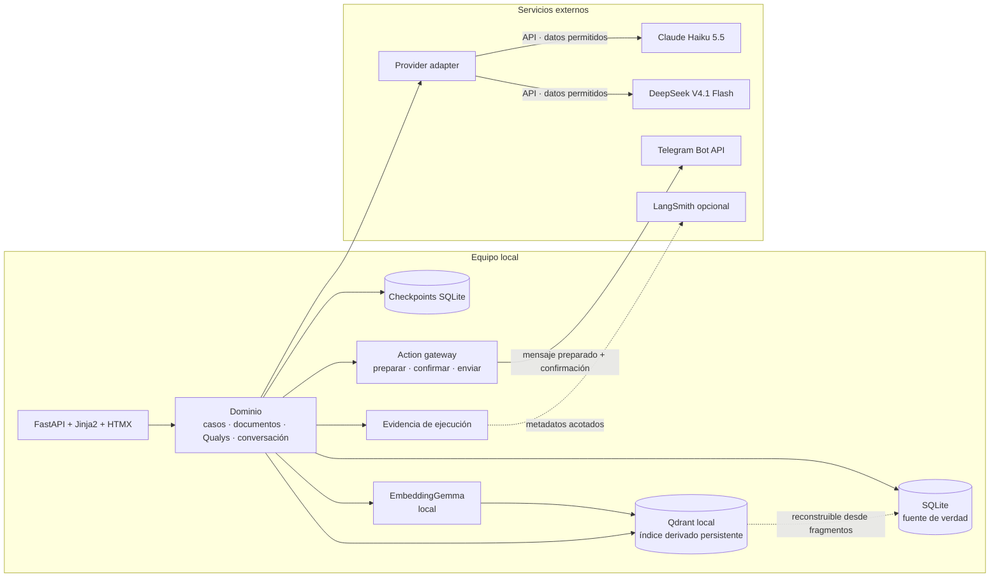

# Hoja de ruta de mejoras — retroalimentación del profesor

**Fecha:** 2026-11-11
**Estado:** propuesta para revisión; no aprobada
**Constitución:** 1.3.0 con ratificación del responsable registrada; acuerdos del equipo no constan
**Alcance:** planificación de arquitectura y funcionalidades. No implementa código, no ejecuta migraciones y no modifica datos.
**Decisión de alcance:** la funcionalidad 003 queda temporalmente suspendida. Las mejoras 004–007 se ejecutan antes de retomarla.

> Este documento distingue lo implementado, lo documentado y lo pendiente. Una capacidad descrita en
> un documento no se considera ejecutada hasta que exista código y una prueba observada. Las
> validaciones históricas de 001 y 002 se conservan; no se reescriben.

## 1. Resumen ejecutivo

SecGuard Advisor es hoy un monolito modular local con FastAPI, SQLite, Chroma, Ollama y LangSmith
opcional. La corrección de alcance general de ciberseguridad empresarial ya está incorporada. La
funcionalidad 003 tiene una especificación aclarada, pero su política P1–P4 sigue siendo una propuesta
no aprobada y la simulación con el CSV filtrado no obtuvo ningún registro clasificable.

La retroalimentación del profesor propone tres cambios de arquitectura:

1. sustituir Chroma por **Qdrant**;
2. sustituir el generador local por **Claude Haiku o DeepSeek mediante API**;
3. incorporar una **acción externa verificable**, empezando por Telegram.

Estos cambios no están implementados. Además, la constitución vigente fija Chroma como índice
permanente y Ollama como inferencia fijada; por tanto, **requieren una enmienda constitucional antes de
especificar las funcionalidades 004 y 005**.

La secuencia recomendada es:

| Orden | ID | Funcionalidad | Resultado esperado |
|---:|---|---|---|
| 1 | 004 | Migración del índice vectorial a Qdrant | Índice Qdrant nuevo desde fragmentos persistidos; sin comparación ni retorno a Chroma |
| 2 | 005 | Generador por API y evaluación del proveedor | Adaptador de proveedor y comparación Claude Haiku / DeepSeek con evidencia |
| 3 | 006 | Destinatarios y notificación operativa | Acción Telegram preparada, confirmada, enviada y evidenciada |
| 4 | 007 | Aceptación integrada y actualización de la demo | Recorrido completo con Qdrant, proveedor elegido y acción externa |
| 5 | 003 | Retomar 003 y el ciclo de clasificación | Política aprobada, contexto y etiquetas antes de entrenar |

## 2. Estado actual comprobado

### 2.1. Implementado y verificado

| Área | Estado real | Evidencia |
|---|---|---|
| Alcance general | La corrección de alcance ya está incorporada: el producto no exige una aplicación de IA y `ai_application` se presenta como «Alcance del análisis». | Código, plantillas, `README.md`, `AGENTS.md`; pruebas de casos. |
| Interfaz | FastAPI + Jinja2 + HTMX, multipágina, Tailwind/Flowbite locales. | `src/secguard_advisor/web`, pruebas de contrato. |
| Dominio | Casos, documentos, recuperación, conversación, vulnerabilidades, evidencia y herramientas separados por paquetes. | `src/secguard_advisor/*`, `README.md`. |
| Persistencia | SQLite es la fuente de verdad; Alembic gestiona el esquema. | `src/secguard_advisor/db`, `alembic/`. |
| Memoria | Checkpoints SQLite separados por conversación, reconciliados antes de cada turno. | `conversation/memory.py`, pruebas de memoria. |
| Índice vectorial | **Chroma persistente** y derivado; se reconstruye desde fragmentos persistidos. | `retrieval/index.py`, `retrieval/collections.py`, `scripts/ingest_corpus.py`. |
| Generador | **Ollama local** con `qwen3.5:9b`; salida estructurada y `ToolDecision`. | `conversation/llm.py`, `web/app.py`, `.env.example`. |
| Embeddings | **Ollama local** con `embeddinggemma`, 768 dimensiones, 2048 tokens de contexto. | `documents/embedding.py`, `config.py`. |
| Evidencia | Ejecuciones, pasos, presupuesto, citas, herramientas y estado de traza en SQLite. | `evidence/`, `web/routes/runs.py`. |
| Trazabilidad externa | LangSmith opcional y acotado a metadatos; sin configuración queda deshabilitado. | `evidence/tracing.py`, `scripts/confirm_trace.py`. |
| Vulnerabilidades | Importación Qualys local, validación, staging, snapshots, filtros y `findings_query`. | `vulnerabilities/`, `tools/findings.py`, 002. |
| 003 | Especificación y checklist aclarados; política P1–P4 **no aprobada**; simulación 0/662 clasificables. | `specs/003-priorizacion-revision-vulnerabilidades/`. |

Verificación local de esta hoja de ruta:

- `uv run pytest -m "not integration" -q` → **417 passed, 35 deselected**.
- Ollama local disponible: `qwen3.5:9b` digest `56671c2ab938`; `embeddinggemma:latest` digest
  `85462619ee72`.
- No se ejecutó la suite de integración completa en esta tarea. El `README.md` documenta
  históricamente `34 passed, 1 skipped`; no se presenta como una ejecución nueva.

### 2.2. Documentado pero no implementado

- **Qdrant** no aparece en código, dependencias ni configuración.
- **Claude/Anthropic y DeepSeek** no están integrados como proveedores del producto. DeepSeek figura
  como proveedor educativo opcional en documentos de planificación y como asistente de codificación;
  ninguna de esas menciones es una integración de producto.
- **Telegram, correo o mesa de ayuda** no tienen código, credenciales ni configuración.
- La **acción externa verificable** no existe.
- La **política P1–P4**, el formulario de revisión y el clasificador de 003 no están implementados.
- **Docker Compose** no está presente en el repositorio; si se elige Qdrant como servidor local, habría
  que añadirlo o documentar una alternativa.
- La **enmienda constitucional** para Qdrant, proveedor API y acción externa no está hecha.

### 2.3. Pendiente de verificación o decisión

- Términos de tratamiento de datos de Anthropic y DeepSeek: no se afirma retención cero, no
  entrenamiento ni garantía de privacidad. Deben revisarse antes de enviar contenido.
- Presupuesto para llamadas pagadas: no aprobado.
- Cuenta, claves y límites de proveedor: no creados.
- Bot de Telegram, destino y política de destinatarios: no definidos.
- Qdrant local: el diseño objetivo recomendado es servidor persistente con Docker Compose; versión,
  volumen, snapshots y concurrencia quedan pendientes de la planificación técnica de 004.
- Suite de integración y aceptación real: no reejecutadas en esta tarea.

## 3. Funcionalidad 003: suspensión y condiciones de retorno

La aclaración más reciente de 003 muestra:

- 662 registros analizados del CSV filtrado;
- 0 registros clasificables con la política propuesta y los datos actuales;
- 662 registros con contexto de exposición/criticidad faltante;
- 654 registros con algún indicador indeterminado, incluidos dentro de los 662.

Se registra que:

- la política P1–P4 sigue **propuesta y no aprobada**;
- las recomendaciones D-01–D-15 **no se aceptan automáticamente**;
- la simulación mide **aplicabilidad de la política**, no precisión ni calidad de un clasificador;
- la funcionalidad 003 queda **temporalmente suspendida**, conservando su especificación y checklist;
- se retomará después de las mejoras de arquitectura y acción operativa, con una estrategia explícita
  de obtención de contexto y etiquetas;
- no se cambia la definición de indeterminado para aumentar artificialmente la cobertura.

**Condición de retorno:** política aprobada o decisión explícita sobre la tabla; fuentes de contexto
definidas; muestra de etiquetas revisada; formulario e historial listos; ninguna etiqueta elegible
antes de la aprobación. El clasificador y el entrenamiento siguen fuera de alcance hasta entonces.

## 4. Arquitectura objetivo



**Frontera de datos:** Qdrant, SQLite, checkpoints y embeddings permanecen locales. El proveedor API
recibe prompts, historial, fragmentos recuperados y resultados de herramientas; Telegram recibe el
contenido del mensaje preparado. LangSmith recibe solo metadatos acotados. Ninguno recibe el CSV
privado completo ni secretos.

## 5. Funcionalidades propuestas

### 5.1. 004 — Migración del índice vectorial a Qdrant

**Problema.** Chroma es un índice embebido derivado; el profesor solicita Qdrant y se necesita un
almacenamiento vectorial persistente, con procedencia y una reconstrucción verificable.

**Resultado esperado.** Qdrant local persistente como único backend documental, con el mismo
contrato de recuperación, aislamiento por caso y citas verificables. SQLite sigue siendo la fuente
de verdad. Chroma deja de ser backend del producto; sus archivos no se borran en 004.

**Alcance mínimo propuesto**

- Adaptador `QdrantIndex` con `upsert`, `delete_ids`, `delete_version`, `count`, `rebuild` y `query`.
- Diseño objetivo de 004: **Qdrant en servidor local persistente, preferiblemente mediante Docker
  Compose**, con acceso limitado al equipo local. El modo embebido se reserva para pruebas o como
  alternativa expresamente documentada.
- Reconstrucción limpia desde los fragmentos persistidos en SQLite; no se migran ni exportan
  vectores de Chroma y no se implementa escritura dual.
- Conservar el alcance actual: una colección pública compartida y una colección por caso, con el
  modelo y la dimensión en el nombre o en un alias sanitizado.
- Payload de procedencia: `chunk_id`, `document_id`, `version_id`, `origin`, `source_id`, `page`,
  `section`, `locator`, `model`, `dimension`, `embedding_version`.
- Búsqueda con el mismo `top_k`, presupuesto de tokens y un umbral calibrado para Qdrant.
- Evaluación funcional reproducible con preguntas y evidencia esperada; no comparación obligatoria
  con Chroma.
- Conservar los datos de SQLite, los archivos Chroma y las citas históricas. No hay selección
  permanente de backend ni retorno a Chroma.

**Opcionales**

- Modo Qdrant embebido (`QdrantClient(path=...)`) para pruebas o como alternativa documentada.
- Snapshots y restauración de colecciones.
- Índices de payload para `document_id`, `version_id`, `origin` y `case_id`.
- Cuantización o tiers de memoria, solo si hay necesidad medida.
- Qdrant Cloud: fuera del primer despliegue.

**Dependencias**

- Constitución 1.3.0 con ratificación del responsable registrada; acuerdos del equipo no constan.
- Cliente `qdrant-client==1.20.0`, servidor Qdrant `1.20.0` local y Docker Compose con volumen
  persistente.
- Adaptador de embeddings sin cambios: **no se cambia el modelo de embeddings en 004**.
- `documents/service.py`, `retrieval/search.py`, scripts de ingesta y fixtures de pruebas.

**Datos afectados**

- Nuevo directorio/volumen de Qdrant y sus colecciones.
- SQLite no cambia como fuente de verdad. Si se registra Qdrant en ejecuciones, preferir metadata
  JSON; si se requiere una columna, será una migración aditiva posterior.
- Los archivos y datos Chroma existentes se conservan intactos; no se usan como backend ni se borran
  en 004.

**Criterios de aceptación**

- Reconstruir Qdrant desde SQLite produce el conjunto esperado de fragmentos y metadatos.
- Las consultas del corpus público y del caso devuelven citas verificables y respetan el aislamiento.
- La evaluación funcional documenta preguntas, evidencia esperada, citas, aislamiento y fallos; no
  exige comparación Chroma/Qdrant.
- Las pruebas de 001/002 siguen pasando.
- Si Qdrant falla, se reconstruye desde SQLite; no hay retorno automático ni manual a Chroma.
- Chroma no se elimina y sus archivos no se modifican en 004.

**Estrategia de pruebas**

- Unitarias del adaptador Qdrant contra un directorio temporal.
- Contrato del adaptador Qdrant y de reconstrucción idempotente.
- Integración de ingesta y recuperación real con embeddings locales.
- Aceptación de reconstrucción, aislamiento entre casos, citas y reinicio.
- Evaluación funcional con un conjunto fijo de preguntas y evidencia esperada.

**Reversión o recuperación**

- Si Qdrant falla, se reconstruye desde SQLite; nunca se reconstruye SQLite desde Qdrant.
- No se borran directorios de índice ni archivos Chroma sin autorización y copia previa.
- No hay retorno a Chroma como capacidad del producto; su limpieza física queda fuera de 004.

**Decisiones pendientes**

| ID | Decisión | Recomendación | Consecuencia |
|---|---|---|---|
| Q-01 | ¿Qdrant embebido o servidor local? | Servidor local persistente con Docker Compose y volumen; embebido solo para pruebas o alternativa documentada | Cambia instalación, concurrencia y operación |
| Q-02 | ¿Una colección por caso o una colección con filtros? | Una por caso + pública, conservando el aislamiento actual | Más colecciones, mayor aislamiento |
| Q-03 | ¿Se registra Qdrant en la evidencia? | Sí, en metadata de ejecución | Permite reproducir qué índice se usó |
| Q-04 | ¿Cómo se recupera Qdrant ante fallos? | Reconstrucción desde SQLite, backups/snapshots y verificación de integridad | No hay rollback a Chroma |
| Q-05 | ¿Se cambia el modelo de embeddings? | No en 004; decisión separada | Evita mezclar dos causas de cambio |

### 5.2. 005 — Generador por API y evaluación del proveedor

**Problema.** El generador actual es Ollama local con `qwen3.5:9b`. El profesor solicita evaluar Claude
Haiku o DeepSeek mediante API. Cambiar de proveedor afecta calidad, herramientas, salida estructurada,
memoria, abstención, presupuesto de contexto, latencia, costo y privacidad.

**Resultado esperado.** Una interfaz de proveedor y dos adaptadores evaluables, sin seleccionar un
ganador por intuición. Ollama se conserva como proveedor local manual, sin fallback automático.

**Alcance mínimo propuesto**

- Protocolo `GeneratorProvider` con `generate`, `decide`, `model`, `provider`, `model_version` y
  `last_usage`.
- Adaptadores:
  - `OllamaProvider` (comportamiento actual).
  - `AnthropicProvider` para Claude Haiku.
  - `DeepSeekProvider` para DeepSeek.
- Configuración explícita de proveedor, modelo y clave; claves fuera de Git y de logs.
- Salida estructurada equivalente a `AnswerPayload` y `ToolDecision`.
- Herramientas y decisión de `findings_query` con el mismo contrato.
- Presupuesto de contexto compatible con cada proveedor.
- Registro de tokens de entrada, salida y caché; costo estimado por turno.
- Errores clasificados, límites y reintentos acotados; sin fallback automático.
- Evaluación comparativa con el mismo conjunto de preguntas y datos públicos o ficticios.

**Opcionales**

- Tercer proveedor o modelo.
- Caché de prompts.
- Streaming.
- Batch API.
- Ajuste de prompts por proveedor, conservando las mismas reglas de evidencia y abstención.

**Dependencias**

- Enmienda constitucional: Ollama está fijado y el proveedor externo es opcional.
- Presupuesto y cuenta autorizados; no se crean cuentas en esta hoja de ruta.
- Política de contenido permitido y revisión de términos de datos.
- Adaptador de conteo de tokens por proveedor.
- Código actual ligado a Qwen/Ollama (ver 5.2.3).
- Pruebas con datos públicos o ficticios; **nunca el CSV privado**.

**Datos afectados**

- Salen del equipo: system prompt, pregunta, historial acotado, fragmentos recuperados, resultados de
  herramientas y la respuesta generada.
- No salen: el CSV privado completo, secretos, rutas locales ni documentos no recuperados.
- Se registran proveedor, modelo, versión, tokens observados, costo estimado y errores.
- Si se añaden columnas de costo/proveedor, será una migración aditiva posterior; no en esta tarea.

**Criterios de aceptación**

- Los adaptadores cumplen el mismo contrato y las pruebas de contrato.
- La salida estructurada es válida y parseable para todas las respuestas.
- La decisión de herramienta y la abstención conservan el comportamiento esperado.
- La memoria y el seguimiento funcionan con el mismo historial.
- El presupuesto de contexto se mide con un método declarado y falla cerrado si no puede medirse.
- Se registran tokens y costo de **todas** las llamadas del turno, incluidas decisión, herramienta y
  reparación.
- La evaluación reporta calidad, citas, herramientas, memoria, abstención, latencia y costo.
- No se declara un ganador sin evidencia comparable.
- Ninguna prueba envía datos privados a un proveedor.

**Estrategia de pruebas**

- Unitarias de adaptadores con dobles de proveedor.
- Contrato de `GeneratorProvider` y de salida estructurada.
- Integración real solo con datos públicos/ficticios y presupuesto autorizado.
- Comparación A/B con el mismo conjunto de preguntas y rúbrica humana.
- Pruebas de error: timeout, 429, 5xx, clave inválida, salida inválida, contexto excedido.
- Pruebas de privacidad: el CSV privado no aparece en prompts ni en logs.

**Reversión o recuperación**

- `SECGUARD_LLM_PROVIDER=ollama` restaura el generador local.
- No hay fallback automático entre proveedores; un fallo se reporta.
- Las claves se revocan y rotan; no se guardan en SQLite.
- Las ejecuciones conservan proveedor/modelo/versión para reproducibilidad.

#### 5.2.1. Código actual que requiere adaptación

| Archivo o área | Acoplamiento actual | Adaptación propuesta |
|---|---|---|
| `conversation/llm.py` | `OllamaGenerator`, `ChatOllama`, `GenerationConfig`, `_usage_of` | Extraer protocolo y mover Ollama a adaptador |
| `conversation/tokenizer.py` | BPE y plantilla Qwen desde GGUF | Añadir contador por proveedor o preflight conservador |
| `conversation/budget.py` | Depende del contador y del prompt local | Mantener contrato; inyectar contador del proveedor |
| `conversation/turn.py` | Registra `generator.model`, `digest` | Registrar proveedor, modelo y versión |
| `conversation/nodes.py` | Llama `generate`, `decide`, `last_usage` | Mantener contrato del protocolo |
| `web/app.py` | `default_llm`, `ollama_probe`, `llm_factory` | Fábrica por proveedor y health check explícito |
| `evidence/tracing.py` | Metadatos de modelo local | Añadir proveedor/modelo/versión, sin contenido |
| `config.py` y `.env.example` | Variables Ollama | Variables de proveedor, modelo y clave |
| `README.md`, `AGENTS.md`, `CONSTITUTION.md` | Documentan Ollama como fijado | Actualizar tras enmienda constitucional |
| Pruebas y fixtures | Ollama y Qwen | Dobles de proveedor y pruebas de contrato |

#### 5.2.2. Evaluación comparable

| Criterio | Cómo se mide | Qué no demuestra |
|---|---|---|
| Calidad de respuesta | Rúbrica humana sobre un conjunto fijo; claridad y corrección | No prueba superioridad universal |
| Citas | Tasa de citas literales válidas y abstención correcta | No prueba verdad de la respuesta |
| Herramientas | Decisión correcta de `findings_query` y argumentos válidos | No mide razonamiento general |
| Salida estructurada | Tasa de JSON válido y campos completos | No mide calidad semántica |
| Memoria | Seguimiento de una segunda pregunta con historial | No prueba memoria infinita |
| Abstención | Respuestas sin evidencia y preguntas fuera de dominio | No demuestra ausencia de evidencia |
| Presupuesto | Tokens de prompt y reducción aplicada | No garantiza el mismo tokenizador |
| Latencia | p50/p95 por turno y por llamada | No es una promesa de servicio |
| Costo | Tokens de todas las llamadas × precio vigente | No incluye impuestos ni cambios futuros |
| Errores | 429, 5xx, timeout, salida inválida y contexto excedido | No cubre todas las fallas del proveedor |

#### 5.2.3. Condiciones oficiales consultadas (2026-11-11)

| Proveedor | Modelo de referencia | Contexto / salida | Precio base observado | Capacidades relevantes | Fuente |
|---|---|---|---|---|---|
| Anthropic | `claude-haiku-5-5` | 1M contexto; 128K salida | Desde $0.10 / MTok entrada y $0.50 / MTok salida | Tool use y structured outputs (JSON schema) | [Models overview](https://platform.claude.com/docs/en/models/overview), [Structured outputs](https://platform.claude.com/docs/en/build-with-claude/structured-outputs), [Tool use](https://platform.claude.com/docs/en/agents-and-tools/tool-use/overview) |
| DeepSeek | `deepseek-flash` (V4.1-Flash-1017) | 1M contexto; hasta 384K salida | Cache miss: $0.15/$0.60 off-peak y $0.30/$1.20 peak por MTok entrada/salida; cache hit: $0.003/$0.006 | JSON output y tool calls; API compatible con formato Anthropic | [Models & Pricing](https://api-docs.deepseek.com/quick_start/pricing) |

Los identificadores, versiones y precios son referencias de evaluación, no reglas constitucionales
permanentes. Deben reverificarse en la documentación oficial al planificar y evaluar 005. El costo
real debe calcularse con los tokens observados de cada turno, el horario peak/off-peak de DeepSeek,
cache hit/miss, reintentos y el sobrecosto de esquemas de herramientas. No se presentan totales
inventados.

**Privacidad:** el uso de una API cambia el tratamiento de datos. Los prompts, fragmentos, historial y
resultados de herramientas dejan el equipo. No se afirma que el proveedor no retenga datos ni que no
entrene con ellos; eso debe verificarse en sus términos vigentes y en la política institucional. Las
pruebas iniciales usan corpus público o datos ficticios. El CSV privado de Qualys no se envía.

### 5.3. 006 — Destinatarios y notificación operativa

**Problema.** El producto aconseja, pero no ejecuta una acción externa verificable. El profesor pide
una notificación o creación de ticket con supervisión humana.

**Resultado esperado.** Una acción operativa preparada por el agente, revisada y confirmada por una
persona, enviada a un destinatario verificado y registrada con evidencia de resultado. Telegram es el
primer canal de evaluación; no es una decisión final del responsable.

**Alcance mínimo propuesto**

- Registro de destinatarios por caso: canal, identificador de destino, nombre visible, consentimiento,
  estado de verificación, fecha, autor declarado y estado activo.
- Credenciales del bot separadas de los datos del destinatario; token en secreto/entorno, no en SQLite.
- Verificación del destino con `getMe`/`getChat` y un mensaje de prueba autorizado.
- Herramienta que **prepara** una acción: caso, snapshot, filtros de 002, resumen, destinatario,
  evidencia y contenido propuesto. No envía.
- Vista previa de contenido y destinatario.
- Confirmación explícita de una persona con identidad declarada y fecha.
- Envío mediante Telegram `sendMessage`; registrar `message_id`, fecha y respuesta del proveedor.
- Evidencia de resultado: preparado, envío solicitado, aceptado por el proveedor, fallido o incierto.
- Prevención de duplicados por clave de acción idempotente.
- Tratamiento de timeout o resultado incierto sin reintento ciego.
- La acción se basa en evidencia y filtros de 002; no depende de P1–P4.
- El agente no crea destinatarios ni inicia envíos por sí solo: solo prepara una acción para un
  destinatario registrado y confirmado por una persona.

**Opcionales**

- Correo electrónico.
- Mesa de ayuda o creación de ticket (Jira, ServiceNow u otra).
- Plantillas por tipo de evento.
- Escalamiento y recordatorios.

Correo requeriría servidor SMTP u OAuth, remitente verificado, directorio de destinatarios, política de
contenido y retención. Mesa de ayuda requeriría API y credenciales del proveedor, proyecto o cola,
esquema de ticket, campos obligatorios y aprobación de acceso. Ninguno se implementa en el primer
corte.

**Dependencias**

- Bot de Telegram, token y destino de prueba autorizados.
- Registro de destinatarios y política de consentimiento.
- Secretos fuera de Git y de logs.
- Revisión de términos de Telegram y retención del contenido.
- 002 para filtros, snapshots y evidencia; 003 no es dependencia.

**Datos afectados**

- Nuevas entidades de destinatario, acción y evidencia; migraciones aditivas posteriores.
- El contenido del mensaje y el `chat_id` salen del equipo hacia Telegram.
- No se envían filas completas del CSV ni documentos no autorizados; solo agregados y referencias.
- El token del bot nunca se persiste en SQLite ni se escribe en trazas.

**Criterios de aceptación**

- Ningún mensaje se envía sin vista previa y confirmación explícita.
- El destinatario está verificado y vinculado al caso.
- La clave idempotente evita duplicados; un reenvío exige una acción nueva.
- El estado distingue preparado, solicitado, aceptado por el proveedor, fallido e incierto.
- «Entregado» o «leído» solo se afirma si existe evidencia; `sendMessage` aceptado no equivale a leído.
- Un timeout no genera reintento ciego ni mensaje duplicado.
- La evidencia conserva contenido, destinatario, autor, fecha y respuesta del proveedor.
- No se registran secretos ni datos personales innecesarios.

**Estrategia de pruebas**

- Unitarias del registro de destinatarios y de la clave idempotente.
- Contrato de preparar/confirmar/enviar.
- Integración con un bot y chat de prueba, no con destinatarios reales.
- Inyección de fallos: timeout, 429, 5xx, chat inválido, token inválido, respuesta ambigua.
- Verificación de que no se envía sin confirmación y que no hay duplicados.
- Privacidad: contenido permitido, token fuera de logs y trazas.

**Reversión o recuperación**

- Deshabilitar el canal y revocar el token.
- Las acciones preparadas se pueden cancelar; las ya aceptadas por Telegram no se pueden “desenviar”
  desde la aplicación.
- Un estado incierto se reconcilia manualmente con el `message_id` o con el destinatario; no se
  reintenta a ciegas.
- El historial de acciones se conserva para auditoría.

**Decisiones pendientes**

| ID | Decisión | Recomendación | Consecuencia |
|---|---|---|---|
| A-01 | ¿Telegram es solo evaluación o canal definitivo? | Evaluación primero; decisión final posterior | Evita comprometer un canal antes de probar |
| A-02 | ¿Quién verifica y confirma? | Una persona con identidad declarada y permiso explícito | Define control humano y auditoría |
| A-03 | ¿De dónde salen los destinatarios? | Registro por caso, con consentimiento y verificación | Evita destinatarios inventados |
| A-04 | ¿Qué contenido puede salir? | Agregados y referencias; sin CSV completo ni secretos | Reduce exposición de datos |
| A-05 | ¿Qué se hace ante timeout? | Estado incierto y revisión manual; sin reintento ciego | Evita duplicados |
| A-06 | ¿Correo o mesa de ayuda? | Posteriores; requieren SMTP/API, credenciales y destino | Añade integración y gobernanza |

**Estados de la acción:** `prepared`, `send_requested`, `provider_accepted`, `failed`, `unknown`.
`delivered` y `read` solo con evidencia adicional; Telegram no se presenta como prueba de lectura.

### 5.4. 007 — Aceptación integrada y actualización de la demo

**Problema.** Los cambios 004–006 deben demostrarse juntos sin romper 001/002 ni mezclar datos reales.

**Resultado esperado.** Un recorrido reproducible con Qdrant, proveedor API elegido y notificación
Telegram, con evidencia, comparación y reversión documentadas.

**Alcance mínimo**

- Instancia de demostración separada con documentos públicos/ficticios y CSV ficticio.
- Qdrant reconstruido desde SQLite.
- Proveedor API seleccionado después de 005; Ollama disponible como comparación manual.
- Pregunta documental con cita; pregunta de memoria; consulta `findings_query`.
- Acción Telegram preparada, confirmada y enviada a un chat de prueba.
- Evidencia de ejecución con proveedor, modelo, tokens, costo y resultado de la acción.
- Evaluación funcional de Qdrant y del proveedor elegido; sin comparación Chroma.
- Actualización de guía, capturas y PDF; sin datos privados.

**Opcionales**

- Comparación A/B de proveedores dentro de la demo.
- Correo o mesa de ayuda como segundo canal.
- Automatización de capturas y PDF.
- Paquete de evidencias exportable.

**Dependencias:** 004, 005, 006, 002; presupuesto y canales aprobados; datos públicos/ficticios.

**Datos afectados:** solo la instancia de demostración separada; no `storage/`, `storage/demo` ni bases
de presentación existentes.

**Criterios de aceptación**

- El recorrido completo funciona con datos ficticios y no envía datos privados.
- Las pruebas de 001/002 y las nuevas de 004–006 pasan.
- La comparación y el costo se reportan con evidencia, no con impresiones.
- La recuperación de Qdrant y la reversión de configuración del proveedor están documentadas; no
  hay retorno a Chroma.
- La guía y el PDF reflejan el estado real; no se declaran aprobaciones inexistentes.

**Estrategia de pruebas:** unitarias, contrato, integración, aceptación y Playwright; proveedor real
solo con datos permitidos y presupuesto autorizado.

**Reversión:** configuración de demo reversible; índices/proveedores anteriores conservados; no se
borran datos de presentación sin autorización.

**Decisiones pendientes:** proveedor ganador, canal, presupuesto máximo, contenido permitido y alcance
de la guía.

### 5.5. 003 — Retomar priorización y ciclo de clasificación

**Problema.** La política P1–P4 no está aprobada y la simulación 0/662 muestra que faltan contexto y
etiquetas. Un clasificador ahora reproduciría una política no validada.

**Resultado esperado.** Política aprobada o revisada, estrategia de contexto y etiquetas, formulario de
revisión y condiciones de elegibilidad. El clasificador se difiere hasta tener etiquetas legítimas.

**Alcance mínimo**

- Aprobar o revisar la política con D-01–D-15.
- Definir fuentes de exposición y criticidad: inventario, arquitectura, clasificación de información,
  responsable del activo, observación fechada.
- Definir cómo se obtendrán etiquetas: revisión humana, muestra, segunda revisión en casos críticos.
- Implementar el formulario de contexto y revisión, con historial y elegibilidad.
- No entrenar ni activar modelos al guardar.

**Opcionales**

- Segunda revisión para casos críticos y muestra estratificada.
- Muestra sintética adicional para fronteras.
- Panel de cobertura de contexto y etiquetas.

**Conservaciones obligatorias**

- `Fixed` como antecedente histórico, sin prioridad de remediación pendiente.
- Separación entre severidad, indicadores y prioridad operacional.
- Bandera conjunta de explotabilidad y malware de 002, sin convertirla automáticamente en P1.
- Instantáneas independientes y aislamiento entre casos.
- Adjudicación explícita de etiquetas e historial por versión de política.
- Información insuficiente y desacuerdo sin forzar P4.
- Ausencia de entrenamiento o activación automática al guardar.
- SC-001 y SC-003 de 001 siguen siendo recomendadas y no bloqueantes; no se convierten en requisitos.

**Dependencias:** 004–007 completos; política y contexto; datos disponibles; revisión humana.

**Datos afectados:** revisiones, contexto, etiquetas y versiones de política; la instantánea Qualys no
se modifica.

**Criterios de aceptación**

- La política está versionada y aprobada antes de generar etiquetas elegibles.
- Cada revisión conserva contexto, justificación, autor, fecha, versión e historial.
- Información insuficiente y desacuerdo no producen etiquetas.
- La simulación de aplicabilidad se repite con el contexto disponible; no se cambia la definición de
  indeterminado para mejorar la cobertura.
- No hay entrenamiento automático.

**Estrategia de pruebas:** aceptación de 003, formulario, historial, elegibilidad y aislamiento; sin
pruebas de clasificador hasta que existan etiquetas.

**Reversión:** desactivar la captura de etiquetas; conservar revisiones; no borrar datos; volver a la
política anterior versionada.

**Decisiones pendientes:** D-01–D-15, fuentes de contexto, tamaño de muestra, quién revisa y cuándo se
considera suficiente para el clasificador.

## 6. Privacidad, datos y costos

### 6.1. Frontera de datos

| Dato | Dónde vive | ¿Sale del equipo? | Condición |
|---|---|---|---|
| Corpus público | SQLite/Qdrant local | Solo fragmentos recuperados al proveedor API | Fuente pública; permitido |
| Documentos del caso | SQLite/originales locales | Fragmentos recuperados al proveedor API | Requiere política de contenido |
| CSV Qualys privado | SQLite local | **No** | Prohibido en prompts, APIs y Telegram |
| Pregunta e historial | SQLite/checkpoints | Al proveedor API | Acotado y minimizado |
| Resultados de herramientas | SQLite | Al proveedor API | Agregados; no `Results` completo |
| Destinatario y mensaje | SQLite/Telegram | A Telegram | Consentimiento y verificación |
| Claves y tokens | Entorno/secreto | No | Nunca en SQLite, logs ni trazas |
| Metadatos de traza | LangSmith | Sí, acotados | Solo si está habilitado |

### 6.2. Política inicial de contenido permitido

1. Pruebas de proveedor con corpus público y datos ficticios.
2. Nada de CSV privado, filas reales, IP, activos ni títulos privados.
3. Fragmentos mínimos: solo los recuperados para la pregunta, no documentos completos.
4. Sin secretos, rutas locales, correos ni identificadores personales innecesarios.
5. Revisar términos de retención/entrenamiento del proveedor antes de ampliar el contenido.
6. LangSmith desactivado o solo metadatos durante la evaluación.

### 6.3. Costos

El costo por turno debe medirse, no estimarse con una tarifa única:

```text
costo_turno =
  Σ llamadas (
    tokens_entrada_cache_miss × precio_entrada
    + tokens_salida × precio_salida
    + tokens_cache_hit × precio_cache
  )
  + sobrecosto de esquemas de herramientas
  + reintentos acotados
```

Debe registrarse por turno: proveedor, modelo, tokens de entrada/salida/caché, número de llamadas,
reintentos, latencia y precio vigente aplicado. Los precios oficiales cambian; se guarda la fecha y la
fuente. No se presentan totales mensuales sin volumen medido.

## 7. Criterios de aceptación por funcionalidad

| ID | Criterios mínimos |
|---|---|
| 004 | Reconstrucción limpia desde SQLite; mismo aislamiento; citas válidas; evaluación funcional sin comparación Chroma; sin dual-write; sin retorno a Chroma; archivos Chroma conservados |
| 005 | Contrato de proveedor; salida estructurada; herramientas; memoria; abstención; presupuesto; tokens/costo; errores; sin datos privados; sin ganador sin evidencia |
| 006 | Destinatario verificado; preparar/vista previa/confirmar/enviar; idempotencia; estados; evidencia; fallos inciertos; sin secretos; sin P1–P4 |
| 007 | Recorrido completo con datos ficticios; pruebas 001/002; comparación; costo; guía/PDF; reversión |
| 003 | Política aprobada; contexto y etiquetas; historial; elegibilidad; sin entrenamiento automático; sin cambiar indeterminados |

## 8. Decisiones pendientes

Ninguna decisión de esta sección está aprobada.

| Grupo | Decisión | Recomendación | Consecuencia práctica |
|---|---|---|---|
| Constitución | Enmienda 1.3.0 y ratificación del responsable | Registrada; acuerdos de Cristian/Ruben no constan | Habilita planificación; no declara ratificación plena del equipo |
| Qdrant | Embebido o servidor local | Servidor local persistente con Docker Compose; embebido para pruebas o alternativa documentada | Cambia instalación y concurrencia |
| Qdrant | Una colección por caso o filtros | Una por caso + pública | Aislamiento fuerte; más colecciones |
| Qdrant | Snapshots y recuperación | Snapshots/backups de Qdrant; no rollback a Chroma | Recuperación sin backend dual |
| Proveedor | ¿Claude Haiku o DeepSeek? | Evaluar ambos; no elegir sin evidencia | Cambia costo, latencia y calidad |
| Proveedor | Presupuesto y límite de gasto | Aprobar tope por evaluación y por demo | Sin presupuesto no hay llamadas |
| Proveedor | Conteo de tokens | Adaptador por proveedor; preflight conservador si no hay tokenizador | Evita exceder contexto |
| Proveedor | Términos de datos | Revisión institucional antes de contenido real | Sin revisión, solo público/ficticio |
| Acción | ¿Telegram definitivo? | Evaluación primero; decisión posterior | Evita compromiso prematuro |
| Acción | Destinatarios y consentimiento | Registro por caso y verificación | Evita envíos inventados |
| Acción | ¿Quién confirma? | Persona con identidad declarada | Control humano |
| Acción | Correo/mesa de ayuda | Posterior; requiere credenciales y destino | Añade alcance operativo |
| 003 | D-01–D-15 | Revisar y aprobar o rechazar explícitamente | Bloquea etiquetas y clasificador |
| 003 | Fuentes de contexto y muestra de etiquetas | Definir antes de retomar | Sin contexto, 0/662 se repite |
| Demo | Proveedor y canal finales | Decidir después de 005/006 | La demo no debe prometer un ganador antes |

## 9. Estado de Spec Kit

La constitución 1.3.0 registra la ratificación comunicada por el responsable y la simplificación de
004. El plan técnico de **`004-qdrant-vector-index`** está preparado en
[`specs/004-qdrant-vector-index/plan.md`](../../specs/004-qdrant-vector-index/plan.md), con Qdrant en
servidor local persistente y reconstrucción limpia desde SQLite.

El siguiente paso sería `/speckit.tasks` solo con autorización expresa; no se ejecutó. No se debe
ejecutar `/speckit.plan` para 003 mientras la política y las decisiones de comportamiento sigan
pendientes. 005 y 006 permanecen posteriores.

## 10. Fuentes consultadas

**Código y documentos del proyecto**

- `src/secguard_advisor/config.py`, `conversation/llm.py`, `conversation/tokenizer.py`,
  `conversation/budget.py`, `retrieval/index.py`, `retrieval/collections.py`, `web/app.py`,
  `documents/embedding.py`, `evidence/`.
- `README.md`, `AGENTS.md`, `CONSTITUTION.md`.
- `docs/planificacion/00-contexto-inicial.md`.
- `specs/003-priorizacion-revision-vulnerabilidades/spec.md` y checklist.
- `../12-SecGuard_Advisor_Propuesta_Consolidada_v1.2.md`.
- `../14-Qualys_Hallazgos_Active_New_ReOpened.csv` y manifiesto, solo para los agregados ya reportados.

**Documentación oficial consultada el 2026-11-11**

- Anthropic, *Models overview*: <https://platform.claude.com/docs/en/models/overview>
- Anthropic, *Structured outputs*: <https://platform.claude.com/docs/en/build-with-claude/structured-outputs>
- Anthropic, *Tool use overview*: <https://platform.claude.com/docs/en/agents-and-tools/tool-use/overview>
- DeepSeek, *Models & Pricing*: <https://api-docs.deepseek.com/quick_start/pricing>
- Qdrant, *Qdrant client local mode*: <https://github.com/qdrant/qdrant-client>
- Qdrant, *Storage*: <https://qdrant.tech/documentation/manage-data/storage/>
- Telegram, *Bot API*: <https://core.telegram.org/bots/api>
- Telegram, *sendMessage*: <https://core.telegram.org/bots/api#sendmessage>

Los precios, modelos y límites son condiciones publicadas sujetas a cambio. No se inventan garantías
de privacidad ni disponibilidad. La evaluación real debe repetir la consulta de estas fuentes y
registrar la fecha.

## 11. Lo que no se hizo

- No se implementó código.
- No se ejecutaron migraciones ni se modificaron datos.
- No se crearon cuentas, claves, bots ni destinos.
- No se enviaron mensajes, correos ni filas a proveedores.
- No se ejecutó `/speckit.plan` para 003.
- No se generaron nuevas especificaciones.
- No se reescribió evidencia histórica.
