# Guía de estudio y demo — SecGuard Advisor

**Fecha de preparación:** 2026-11-09  
**Instancia usada para las capturas:** `$HOME/.local/share/secguard-presentacion`  
**Servidor de la demo:** `http://127.0.0.1:8767`  
**Naturaleza de los datos:** escenario educativo ficticio y corpus público oficial. No hay datos de una empresa real en las capturas.

> Esta guía es material de estudio y respaldo. No sustituye la demo en vivo ni presenta la funcionalidad 003, la política P1–P4, el clasificador, el entrenamiento, MLflow o Prefect como disponibles.

## 1. Resumen oral de 60 segundos

### Guion para decir

> SecGuard Advisor nace de un problema concreto: revisar la seguridad de una aplicación de IA exige cruzar políticas, documentos y hallazgos técnicos, y muchas veces no se sabe de dónde sale una respuesta. El producto convierte ese trabajo en un caso acotado: recibe documentos y un CSV de Qualys, conserva la procedencia y permite preguntar en español. Cada respuesta documental muestra citas literales y permite abrir el fragmento; las consultas de vulnerabilidades se responden con una herramienta que cuenta en SQLite, no con el modelo. Todo queda en una ejecución visible: modelo, pasos, duración y estado de la traza. Usa modelos locales, así que no hay factura de API por consulta; el equipo, la electricidad y el tiempo no están medidos. Hoy reduce búsqueda manual y mejora la trazabilidad; no prioriza automáticamente ni garantiza seguridad.

**Conteo aproximado:** 126 palabras.

### Cuatro frases para memorizar

1. **Problema:** cruzar evidencia dispersa y no saber de dónde sale una respuesta.
2. **Datos:** documentos del caso, corpus público y CSV autorizado, cada uno con procedencia.
3. **Evidencia:** citas abiertas, conteos en SQLite y ejecución visible.
4. **Costo:** inferencia local sin factura por token; equipo, electricidad y tiempo no medidos.

### Lo que no conviene decir

- «El sistema prioriza automáticamente con P1–P4.» **No está implementado.**
- «Elimina vulnerabilidades.» **No ejecuta remediaciones.**
- «Garantiza seguridad.» **Es un consultor defensivo, no una certificación.**
- «El proyecto cuesta cero.» **No hay factura de API por las llamadas locales, pero el equipo, la electricidad y el tiempo tienen costo no medido.**

## 2. Qué está construido hoy

### Funcionalidad 001 — consulta documental

Está implementada y validada localmente:

- creación y reapertura de casos con contexto educativo;
- carga de PDF textual y Markdown, estados, versiones y fragmentos localizables;
- ingesta de corpus público oficial;
- consulta en español con recuperación documental;
- respuestas con citas literales, control automático de citas y abstención cuando falta evidencia;
- revisión humana del respaldo semántico de una cita, separada del control automático;
- memoria por caso en checkpoints separados;
- navegación multipágina y menú móvil;
- herramienta `findings_query` para hallazgos sintéticos;
- evidencia de ejecución: modelo, pasos, fuentes, herramientas, duración y estado de la traza.

### Funcionalidad 002 — vulnerabilidades Qualys

Está implementada y validada localmente:

- carga del CSV filtrado de Qualys por formulario;
- validación local, filas válidas, rechazo y vista previa;
- confirmación de instantáneas independientes e inmutables;
- historial y selector de instantáneas;
- tabla con estado, severidad 1–5, indicadores, prioridad conjunta y procedencia;
- filtros por estado, severidad, prioridad, explotabilidad, malware, activo, QID y CVE;
- consulta estructurada mediante `findings_query`, con conteos en SQLite;
- `Results` completo fuera del modelo y de la interfaz;
- separación entre documentos, RAG y registros Qualys;
- evidencia histórica sobre el snapshot persistido.

### Qué falta del incremento 3

La funcionalidad 003 está **suspendida temporalmente** y no se presenta como disponible:

- política operacional P1–P4 aprobada;
- formulario de revisión de prioridad;
- etiquetas elegibles para entrenamiento;
- clasificador, entrenamiento, reentrenamiento, MLflow, Prefect, promoción, rollback, exportación y empaquetado operativo.

El escenario del producto es educativo y configurable; no está ligado a una empresa específica. La instancia de la demo usa una organización ficticia, **DemoSeguridad**, y datos marcados como sintéticos.

## 3. Recorrido comentado de la aplicación

Las capturas se tomaron en una instancia separada, con `LANGSMITH_TRACING=false`. Las respuestas son reales de Ollama en esa instancia; no son texto inventado para la guía.

### 3.1. Casos

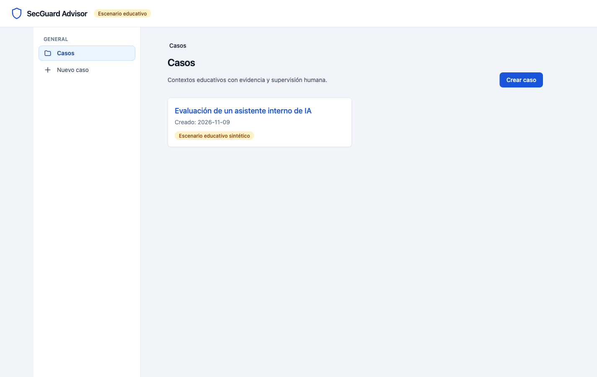
*Figura 1. Casos: el escenario educativo y su marca sintética.*

**Qué hacer:** abrir `http://127.0.0.1:8767/cases`.

**Qué decir:** «El producto trabaja por caso. Este es un escenario educativo ficticio sobre un asistente interno de IA; no es una empresa real.»

**Qué debería verse:** un caso, «Evaluación de un asistente interno de IA», con la marca «Escenario educativo sintético».

**Qué evidencia demuestra:** el alcance por caso y la separación entre contexto educativo y datos reales.

**Tiempo aproximado:** 20 segundos.

---

### 3.2. Resumen del caso

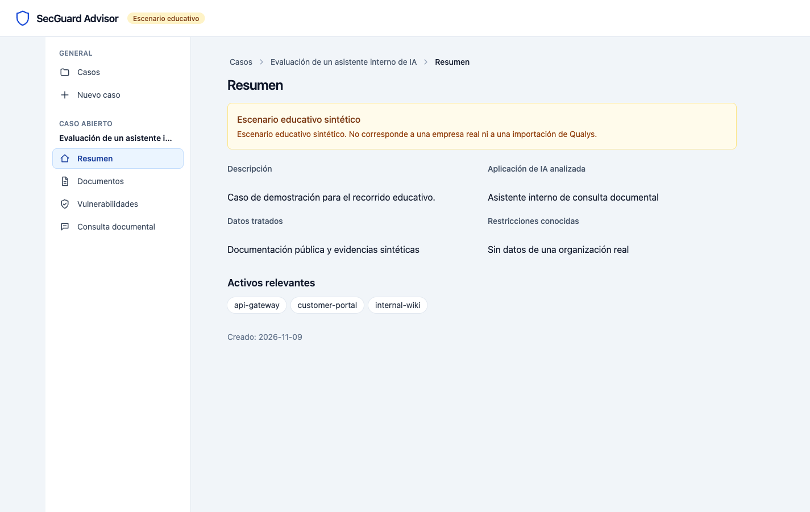
*Figura 2. Resumen del caso: contexto, aplicación de IA, restricciones y activos.*

**Qué hacer:** abrir el caso.

**Qué decir:** «El caso guarda el contexto mínimo: qué aplicación de IA se evalúa, qué datos trata, qué restricciones existen y qué activos son relevantes. Los campos que faltan se muestran como desconocidos; no se inventan.»

**Qué debería verse:** descripción, aplicación de IA, datos tratados, restricciones y tres activos: `api-gateway`, `customer-portal` e `internal-wiki`.

**Qué evidencia demuestra:** que el agente no responde en el vacío: el alcance y el contexto están persistidos y se imponen en el servidor.

**Tiempo aproximado:** 20 segundos.

---

### 3.3. Documentos del caso

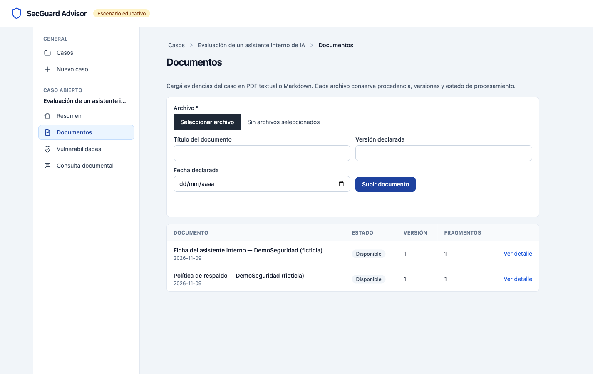
*Figura 3. Documentos ficticios cargados, con estado y procedencia.*

**Qué hacer:** entrar en «Documentos».

**Qué decir:** «Cargamos dos documentos ficticios de DemoSeguridad: la política de respaldo y la ficha del asistente. Ambos quedan disponibles, con versión y estado. El corpus público oficial se ingesta aparte y también tiene procedencia.»

**Qué debería verse:** los documentos «Política de respaldo — DemoSeguridad (ficticia)» y «Ficha del asistente interno — DemoSeguridad (ficticia)», en estado «Disponible».

**Qué evidencia demuestra:** carga, extracción, fragmentación y estado de procesamiento; el contenido del caso no se mezcla con el corpus público.

**Tiempo aproximado:** 30 segundos.

---

### 3.4. Consulta documental con respuesta real

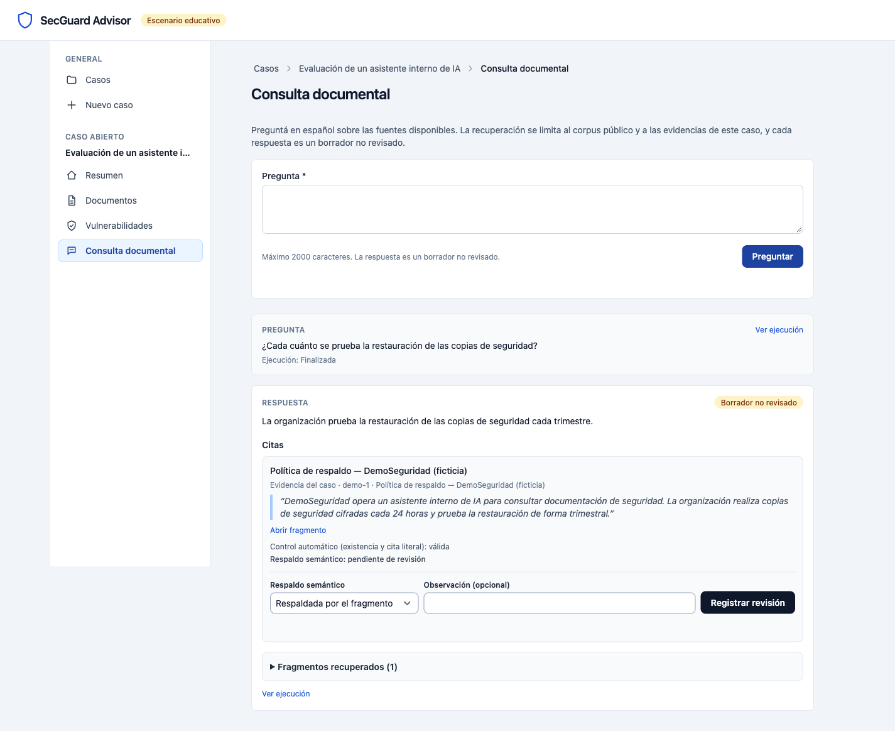
*Figura 4. Respuesta documental real con cita literal del caso.*

**Acción realizada:** preguntar «¿Cada cuánto se prueba la restauración de las copias de seguridad?».

**Respuesta observada:**

> «La organización prueba la restauración de las copias de seguridad cada trimestre.»

**Qué decir:** «La respuesta no es una afirmación suelta: trae una cita literal del documento del caso, muestra la procedencia y separa el control automático de la revisión humana.»

**Qué debería verse:** respuesta, cita de «Política de respaldo — DemoSeguridad (ficticia)», control automático «válida» y respaldo semántico «pendiente de revisión».

**Qué evidencia demuestra:** recuperación documental, cita verificable y distinción entre control automático y revisión humana.

**Tiempo aproximado:** 1 minuto.

---

### 3.5. Cita abierta en el fragmento fuente

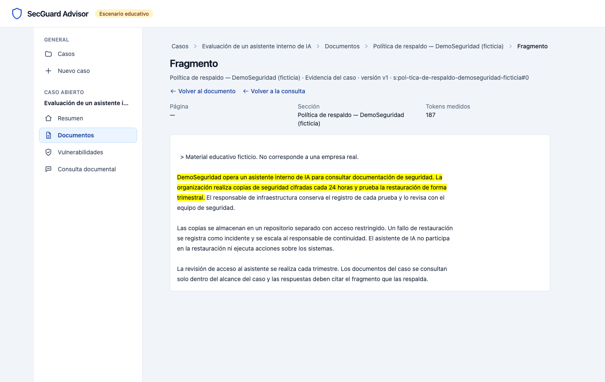
*Figura 5. Fragmento fuente abierto desde la cita.*

**Qué hacer:** pulsar «Abrir fragmento».

**Qué decir:** «El enlace lleva al fragmento exacto que sostiene la respuesta. La persona puede leer el contexto completo y decidir si la cita respalda la afirmación.»

**Qué debería verse:** el documento, la versión y el fragmento con la frase citada.

**Qué evidencia demuestra:** trazabilidad de la cita hasta el fragmento localizable; no se pide confiar en una cita decorativa.

**Tiempo aproximado:** 30 segundos.

---

### 3.6. Segunda pregunta y memoria

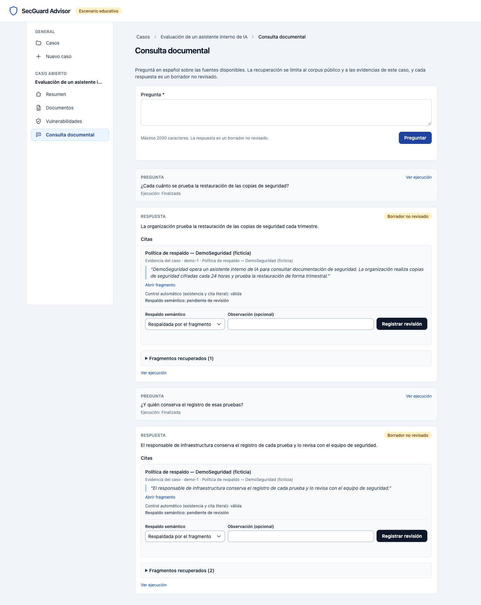
*Figura 6. Segunda pregunta respondida con el historial del caso.*

**Acción realizada:** preguntar «¿Y quién conserva el registro de esas pruebas?».

**Respuesta observada:**

> «El responsable de infraestructura conserva el registro de cada prueba y lo revisa con el equipo de seguridad.»

**Qué decir:** «La segunda pregunta usa el contexto de la primera. La conversación no empieza de cero: el historial del caso se conserva y se reconcilia antes del turno.»

**Qué debería verse:** dos preguntas y dos respuestas en el mismo historial, con citas del mismo documento.

**Qué evidencia demuestra:** memoria por caso y continuidad conversacional; el historial no se usa como evidencia documental, las citas se validan contra los fragmentos del turno.

**Tiempo aproximado:** 1 minuto.

---

### 3.7. Formulario de vulnerabilidades

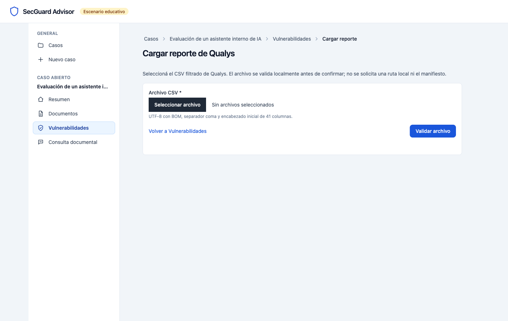
*Figura 7. Formulario de carga del CSV ficticio.*

**Qué hacer:** entrar en «Vulnerabilidades» → «Cargar reporte de Qualys».

**Qué decir:** «El CSV se valida localmente. No se pide una ruta local ni se envía el archivo a un servicio externo. El archivo de esta demo es ficticio y se llama `hallazgos-demo-ficticios.csv`; el adaptador se probó aparte con un CSV real autorizado de 662 registros.»

**Qué debería verse:** campo de archivo, botón «Validar archivo» e indicador de carga.

**Qué evidencia demuestra:** el flujo de carga y la separación entre el CSV de demostración y el archivo real de aceptación.

**Tiempo aproximado:** 30 segundos.

---

### 3.8. Vista previa y confirmación

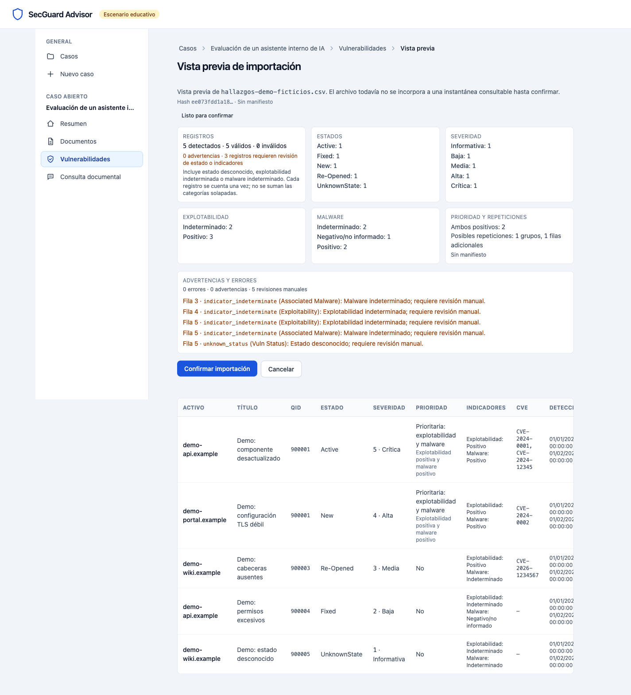
*Figura 8. Vista previa del CSV ficticio antes de confirmar.*

**Qué hacer:** validar el CSV ficticio.

**Qué decir:** «La vista previa muestra 5 registros válidos, 0 inválidos y la distribución por estado, severidad e indicadores. Todavía no es una instantánea consultable; recién se incorpora al confirmar.»

**Qué debería verse:** «Listo para confirmar», 5 detectados, 5 válidos, estados `Active`, `New`, `Re-Opened`, `Fixed` y desconocido, y la distribución de severidad 1–5.

**Qué evidencia demuestra:** validación por fila, rechazo explícito y confirmación como acto separado.

**Tiempo aproximado:** 30 segundos.

---

### 3.9. Tabla, filtros y procedencia

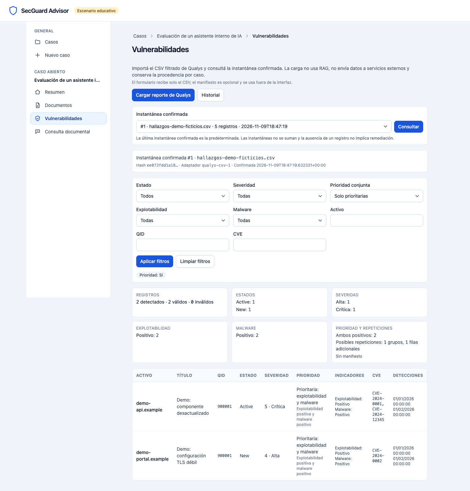
*Figura 9. Tabla con filtro de prioridad y procedencia de la instantánea.*

**Qué hacer:** confirmar la importación y aplicar el filtro «Prioridad: Sí».

**Qué decir:** «La tabla conserva la instantánea confirmada y su procedencia. El filtro de prioridad conjunta muestra solo los registros con explotabilidad y malware positivos; los conteos se calculan en SQLite.»

**Qué debería verse:** «Importación confirmada», la instantánea #1, el filtro activo y los registros con prioridad conjunta.

**Qué evidencia demuestra:** instantáneas independientes, filtros, prioridad conjunta y procedencia. La bandera de prioridad conjunta **no** es una prioridad P1–P4.

**Tiempo aproximado:** 30 segundos.

---

### 3.10. Consulta conversacional con `findings_query`

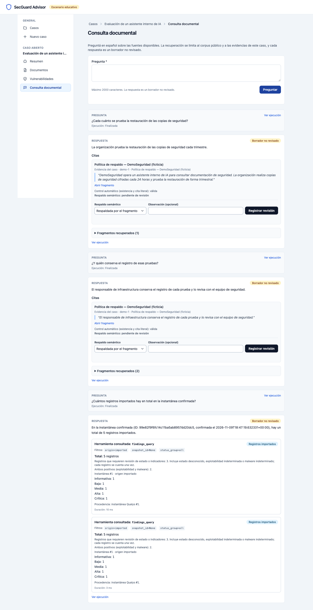
*Figura 10. Respuesta de `findings_query` con total 5 y procedencia.*

**Acción realizada:** preguntar «¿Cuántos registros importados hay en total en la instantánea confirmada?».

**Respuesta observada:**

> «En la instantánea confirmada (ID: 99e82f9f6fc14c11ba5ab8957dd20dc5, confirmada el 2026-11-09T18:47:19.632331+00:00), hay un total de 5 registros importados.»

**Qué decir:** «El modelo no contó a mano: solicitó `findings_query`. La herramienta devolvió total 5, la instantánea #1 y la procedencia. El resultado coincide con SQLite: 5 registros.»

**Qué debería verse:** la respuesta, la tarjeta «Herramienta consultada: findings_query», total 5, distribución de severidad, «Instantánea #1 · origen importado» y «Procedencia: instantánea Qualys #1».

**Qué evidencia demuestra:** consulta estructurada, conteo en SQLite, procedencia y separación del RAG. La respuesta no tiene citas documentales porque los registros Qualys no son documentos RAG.

**Tiempo aproximado:** 1 minuto.

---

### 3.11. Evidencia de ejecución

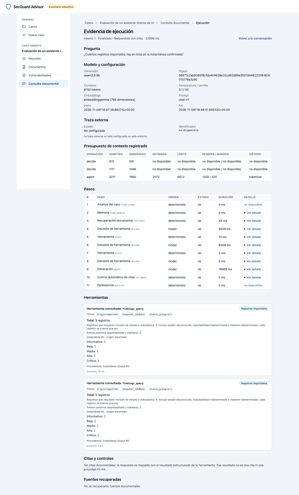
*Figura 11. Evidencia de ejecución: modelo, pasos, herramienta y traza no configurada.*

**Qué hacer:** pulsar «Ver ejecución» en la pregunta de vulnerabilidades.

**Qué decir:** «La ejecución muestra el modelo `qwen3.5:9b`, su digest, el contexto, la temperatura, la semilla, los embeddings, la versión del prompt, la duración de 32.998 s, los pasos y la herramienta. La traza externa está “No configurada”: no se inventó una traza.»

**Qué debería verse:** modelo, configuración, presupuesto, pasos (decisión, herramienta, generación), duración total y estado de traza «No configurada».

**Qué evidencia demuestra:** observabilidad local; la ejecución es auditable aunque LangSmith no esté configurado. La traza externa es opcional.

**Tiempo aproximado:** 30 segundos.

**Nota:** en `docs/evidencia/demo-001.md` existe una traza confirmada de una instancia temporal de aceptación. Es evidencia histórica separada; no pertenece a esta sesión y no se atribuye a la demo actual.

---

### 3.12. Abstención ante falta de evidencia

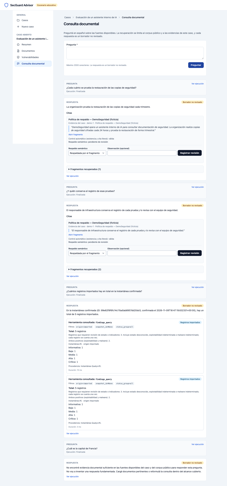
*Figura 12. Abstención ante una pregunta sin evidencia documental.*

**Acción realizada:** preguntar «¿Cuál es la capital de Francia?».

**Respuesta observada:**

> «No encontré evidencia documental suficiente en las fuentes disponibles del caso y del corpus público para responder esta pregunta. No voy a inventar una respuesta fundamentada. Cargá documentos pertinentes o reformulá la consulta dentro del alcance cubierto.»

**Qué decir:** «Cuando no hay evidencia, el sistema se abstiene. No inventa una cita para completar la respuesta. Esto es una virtud del consultor defensivo: la ausencia de evidencia se registra como ausencia, no como riesgo bajo.»

**Qué debería verse:** respuesta de abstención, sin citas inventadas y con la ejecución registrada.

**Qué evidencia demuestra:** abstención y límite explícito; una recuperación vacía no demuestra ausencia de evidencia.

**Tiempo aproximado:** 40 segundos.

## 4. Arquitectura explicada

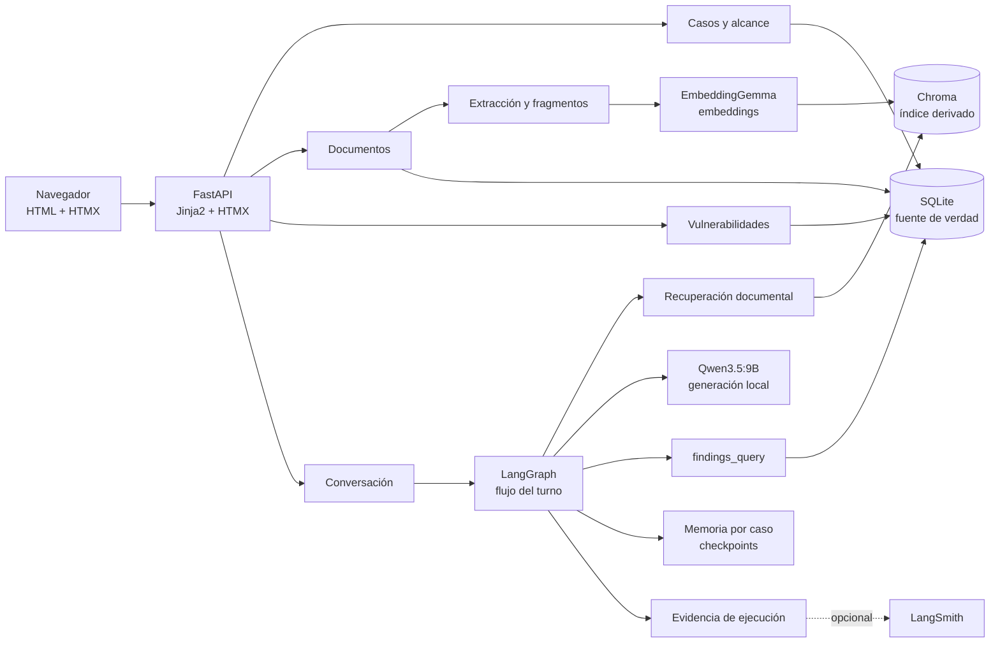

### Cómo leer el diagrama

- **Navegador + HTMX:** la interfaz es multipágina con renderizado del servidor. HTMX actualiza secciones sin convertir la aplicación en una SPA.
- **FastAPI + Jinja2:** rutas, servicios y plantillas. El alcance del caso se resuelve en el servidor antes de consultar datos.
- **SQLite:** fuente de verdad para casos, documentos, fragmentos, mensajes, hallazgos, ejecuciones, citas y revisiones. Conserva procedencia.
- **Chroma:** índice vectorial derivado y reconstruible para búsqueda documental. No es la fuente de verdad.
- **LangGraph:** flujo del turno: alcance, memoria, recuperación, decisión de herramienta, herramienta, generación, validación y persistencia.
- **Ollama:** dos modelos con funciones distintas:
  - `qwen3.5:9b`: genera la respuesta y la decisión estructurada de herramienta.
  - `embeddinggemma`: convierte documentos y consultas en vectores para recuperación. No genera texto.
- **`findings_query`:** herramienta acotada al caso para contar y agrupar registros Qualys en SQLite. No usa el modelo para sumar ni devuelve `Results` completo.
- **Memoria:** checkpoints por caso, separados del estado de negocio y reconciliados antes de cada turno.
- **Evidencia:** cada ejecución registra modelo, pasos, fuentes, herramientas, duración y estado de traza. LangSmith es opcional; sin configuración queda `disabled`.

### Ruta A — documentos

```text
Documento PDF/Markdown
  → validación y extracción
  → fragmentos localizables
  → embeddings locales
  → Chroma
  → recuperación para la pregunta
  → respuesta con citas literales
  → control automático de citas
  → revisión humana del respaldo semántico
```

El corpus público y las evidencias del caso se mantienen separados. La respuesta documental cita fragmentos y puede abrir el origen.

### Ruta B — vulnerabilidades

```text
CSV Qualys
  → validación local
  → vista previa
  → confirmación de instantánea inmutable
  → SQLite
  → findings_query
  → conteos y grupos
  → respuesta con procedencia estructurada
```

El CSV de Qualys **no** se incorpora al RAG, no se convierte en documento, no se indexa en Chroma y no produce citas documentales. Sus registros se consultan por SQLite y se presentan como evidencia estructurada.

## 5. Datos y evidencia

| Fuente | Qué es | Dónde vive | Qué demuestra | Límite |
|---|---|---|---|---|
| Corpus público oficial | NIST CSWP 29, NIST AI 100-1, NIST AI 600-1 y OWASP Top 10 LLM 2025 | `data/corpus`, ingerido en SQLite/Chroma | Recuperación con procedencia pública y citas | No es evidencia del caso |
| Evidencias del caso | Dos documentos Markdown ficticios de DemoSeguridad | SQLite del caso; índice del caso | Consulta documental con citas del caso | Son ficticios y educativos |
| CSV ficticio de demo | `hallazgos-demo-ficticios.csv`, 5 filas, 41 columnas | SQLite como instantánea importada | Formulario, validación, confirmación, tabla y `findings_query` | No es un CSV real |
| CSV real autorizado | CSV filtrado de Qualys de 662 registros | Solo aceptación local separada | Agregados de validación y consulta real | No se versiona ni se muestra por filas |
| Hallazgos sintéticos | Dataset `demo-findings`, 12 hallazgos y 3 activos | SQLite del caso | Herramienta y procedencia sintética | No es una empresa real |
| Datos faltantes | Exposición, criticidad, contexto de IA, P1–P4, etiquetas revisadas | — | Límites declarados | No se inventan |

### Evidencia de aceptación con el CSV real

La aceptación real se ejecutó en una instancia temporal separada, con `LANGSMITH_TRACING=false`, sin abrir el reporte original de 62 MB. Solo se registraron agregados:

| Métrica | Valor observado |
|---|---|
| Registros | 662 |
| Columnas | 41 |
| Active / New / Re-Opened / Fixed | 631 / 10 / 21 / 0 |
| Severidad 1/2/3/4/5 | 20 / 316 / 94 / 162 / 70 |
| Explotabilidad positiva / indeterminada | 129 / 533 |
| Malware positivo / indeterminado | 8 / 654 |
| Ambos positivos | 8 |
| Registros con múltiples CVE | 179 |
| Grupos de posibles repeticiones | 10 |
| Filas adicionales | 11 |

Reporte: [`../evidencia/002-corte-5/aceptacion-real.md`](../evidencia/002-corte-5/aceptacion-real.md).

### Pruebas y estados

| Tipo | Resultado observado | Cómo interpretarlo |
|---|---|---|
| Pruebas rápidas | `make check` → 409 passed, 35 deselected | Suite sin integración real |
| Integraciones | `make test-integration` → 34 passed, 1 skipped en 13:41 | La omitida es LangSmith real, no configurado |
| Aceptación real 002 | `test_qualys_import_real.py` → 1 passed en 1:35 | CSV real y tres consultas Ollama; agregados |
| Aceptación real 001 | Histórica: 25 passed en 881 s y recorrido real con Ollama | Ver [`../evidencia/demo-001.md`](../evidencia/demo-001.md) |
| Navegador de esta demo | 0 errores de consola; recursos locales sin 4xx/5xx | Chromium vía Playwright MCP |
| SC-001 / SC-003 | No ejecutadas | Validaciones humanas recomendadas, no bloqueantes |
| CI remota | No ejecutada | No hay remoto; no se declara CI en verde |

### Qué no se debe afirmar

- No se ejecutó una validación empresarial.
- No hay clientes ni mediciones de ahorro.
- No hay aprobación académica.
- No hay P1–P4 aprobadas ni clasificador entrenado.
- La traza confirmada de `demo-001` pertenece a una instancia temporal histórica, no a esta demo.

## 6. Costos

| Concepto | Situación observada | Qué se puede decir |
|---|---|---|
| Inferencia local por tokens | Ollama local; no hay factura de API por las llamadas de producto | «No hay factura por token en estas consultas; el cómputo local sí tiene costo» |
| Equipo | Apple M5, macOS 27.0.1, 24 GiB de memoria | Recurso existente; precio de compra no medido |
| Modelos | `qwen3.5:9b` ≈ 6,55 GB; `embeddinggemma` ≈ 0,62 GB | Almacenamiento local; no es un servicio pago |
| Instancia de demo | ≈ 7,7 MB | Base SQLite, Chroma y estado local |
| Corpus | ≈ 13 MB de originales | Documentos públicos oficiales |
| Electricidad | No medida | No se presenta como gratuita ni se inventa una tarifa |
| Amortización del equipo | No medida | No se inventa precio ni vida útil |
| Servicios externos | LangSmith desactivado; DeepSeek no usado por el producto | Sin cargos verificados en esta demo |
| Desarrollo | `uv`, Python 3.14.6, Node 26.11.1, pytest, Ruff, pre-commit, Playwright MCP | Herramientas locales; costo no medido |
| Modelo usado para construir el código | Asistente de codificación DeepSeek V4.1 Flash vía OpenCode | Se contabiliza aparte del modelo que ejecuta el producto; facturación no verificada |
| Hosting / dominio | No usados | Fuera de la demo local |

**Latencia observada en esta instancia** (no es p95; es una medición individual del ensayo):

| Pregunta | Duración | Observación |
|---|---:|---|
| Restauración de copias | 39,360 s | Primera consulta de la sesión; el modelo se cargó durante el ensayo |
| Seguimiento de memoria | 23,762 s | Modelo ya cargado |
| Conteo importado con `findings_query` | 32,998 s | Dos llamadas a `findings_query` y varias decisiones |
| Abstención | 16,416 s | Sin generación de citas |

No se presenta una medición individual como p95. La latencia depende del equipo, la carga del modelo y la longitud de la respuesta.

## 7. Decisiones para explicar sin leer

**¿Por qué SQLite y Chroma?**  
SQLite es la fuente de verdad: casos, documentos, hallazgos, mensajes, ejecuciones y procedencia. Chroma es un índice derivado para búsqueda; se puede reconstruir sin perder datos de negocio.

**¿Por qué un modelo local?**  
Privacidad y control: los datos no se envían por defecto a una API externa y no hay factura por token. La contrapartida es que la latencia y la calidad dependen del equipo y del modelo instalado. Es un objetivo de privacidad, no una garantía absoluta de seguridad.

**¿Para qué sirven los embeddings?**  
Convierten documentos y preguntas en vectores para recuperar fragmentos relevantes. No generan la respuesta; solo ayudan a encontrar evidencia.

**¿Cómo verifican una respuesta?**  
La respuesta documental debe traer una cita literal de un fragmento recuperado en ese turno. El control automático comprueba existencia y coincidencia; la persona puede abrir el fragmento y revisar el respaldo semántico por separado.

**¿Cómo evitan mezclar casos?**  
El alcance se impone en el servidor antes de consultar SQLite, Chroma o memoria. `findings_query` recibe el caso por clausura y no acepta `case_id` como argumento. Las colecciones y los checkpoints se separan por caso.

**¿Qué aporta frente a consultar un chatbot directamente?**  
Procedencia, citas abiertas, conteos estructurados en SQLite, separación entre documentos y vulnerabilidades, memoria por caso y evidencia de ejecución. No garantiza la verdad; hace más fácil auditar de dónde sale una respuesta.

**¿Qué sucede si falta evidencia?**  
El sistema se abstiene y no inventa una cita. Un total 0 en `findings_query` no demuestra ausencia de vulnerabilidades ni riesgo bajo.

**¿Qué está pendiente?**  
La política P1–P4, el formulario de revisión de prioridad, las etiquetas elegibles, el clasificador, el entrenamiento, MLflow, Prefect, promoción, rollback, exportación y empaquetado. También SC-001/SC-003, la CI remota y la revisión en otros navegadores.

## 8. Guion de los 15 minutos

La siguiente distribución es una **sugerencia**; no fue acordada por el equipo.

| Minuto | Bloque | Quién (sugerencia) | Qué hacer |
|---|---|---|---|
| 0:00–1:00 | Contexto, problema y solución | Edwin | Resumen de 60 segundos y una frase de alcance: consultor defensivo, no remediación |
| 1:00–2:00 | Caso y documentos | Cristian | Abrir caso, resumen y documentos; explicar datos y procedencia |
| 2:00–4:00 | Consulta documental y cita | Cristian | Hacer la pregunta de respaldo, abrir la cita y mostrar control automático vs revisión humana |
| 4:00–5:00 | Memoria | Cristian | Segunda pregunta de seguimiento |
| 5:00–6:30 | Vulnerabilidades | Ruben | Formulario, vista previa, confirmación y tabla con filtros |
| 6:30–7:30 | `findings_query` y evidencia | Ruben | Pregunta de conteo, comparar con SQLite, abrir evidencia de ejecución |
| 7:30–8:00 | Abstención | Ruben | Pregunta fuera de alcance y explicar el límite |
| 8:00–9:30 | Arquitectura y decisiones | Edwin / Ruben | Diagrama, SQLite/Chroma, modelo local, embeddings y dos rutas |
| 9:30–11:00 | Repositorio, pruebas y costos | Edwin | README, commits, suite, aceptación real y costo local |
| 11:00–15:00 | Preguntas y compromisos | Todos | Responder y proponer compromisos para el 20 de noviembre |

**Camino de respaldo si una generación demora demasiado:** si una respuesta documental tarda más de 20–30 segundos, no esperar en silencio. Decir «la inferencia es local y la primera carga del modelo tarda», mostrar la captura `04-consulta-documental.png` o `05-cita-fragmento.png` y continuar con vulnerabilidades, que usa SQLite y es más rápida. Las capturas corresponden a este ensayo y deben declararse como respaldo, no como ejecución en vivo.

**No llenar los cuatro minutos de retroalimentación con exposición adicional.** Dejar tiempo para preguntas y compromisos.

## 9. Preparación previa y contingencias

### Instancia usada

La instancia de esta guía está fuera del repositorio y es separada de `storage/` y `storage/demo`:

```bash
export DEMO_DIR="$HOME/.local/share/secguard-presentacion"
export REPO="/Users/edwinandperez/Documents/InfoArbegas/Documents/ICESI/CLASES/SEM III/Proyecto III/Proyecto Final/secguard-advisor"
```

### Preparar desde cero, solo si la instancia no existe

No ejecutar durante la demo. No borra `storage/` ni `storage/demo`.

```bash
cd "$REPO"
uv sync --locked
npm ci
make assets

mkdir -p "$DEMO_DIR"
SECGUARD_STORAGE_DIR="$DEMO_DIR" LANGSMITH_TRACING=false uv run alembic upgrade head
SECGUARD_STORAGE_DIR="$DEMO_DIR" LANGSMITH_TRACING=false uv run python scripts/prepare_demo.py
```

`prepare_demo.py` requiere el corpus oficial ya descargado. No descarga el reporte original ni toca `storage/demo`.

### Arrancar la misma instancia de las capturas

```bash
cd "$REPO"
SECGUARD_STORAGE_DIR="$DEMO_DIR" \
SECGUARD_REVIEWER_NAME="Equipo de demostración" \
LANGSMITH_TRACING=false \
uv run uvicorn --factory secguard_advisor.web.app:create_app \
  --host 127.0.0.1 --port 8767 --workers 1
```

Comprobar:

```bash
curl -s -o /dev/null -w "%{http_code}\n" http://127.0.0.1:8767/healthz
# 200
curl -s http://127.0.0.1:11434/api/tags
```

Abrir `http://127.0.0.1:8767/cases`.

### Antes de iniciar el cronómetro

- Servidor arrancado y `/healthz` en 200.
- Ollama con `qwen3.5:9b` y `embeddinggemma` disponibles.
- Pestañas abiertas: casos, documentos, consulta documental, vulnerabilidades y la carpeta de capturas.
- Caso «Evaluación de un asistente interno de IA» abierto.
- Documentos ficticios cargados y en estado «Disponible».
- Conversación de ensayo visible o lista para empezar.
- CSV ficticio localizado en `docs/presentacion/insumos-demo/hallazgos-demo-ficticios.csv`.
- Capturas localizadas en `docs/presentacion/imagenes/`.
- Revisar que no haya datos privados en pantalla.

### Si falla Ollama

1. No modificar la aplicación para simular disponibilidad.
2. Comprobar `curl -s http://127.0.0.1:11434/api/tags`.
3. Si no responde, explicar que la inferencia es local y mostrar las capturas de la consulta documental, la cita, la memoria y la abstención.
4. Continuar con vulnerabilidades, que no necesita el modelo para la tabla y los conteos; `findings_query` sí requiere el modelo para decidir la herramienta, pero la tabla y SQLite se pueden mostrar.
5. Declarar que las capturas son de un ensayo previo y que la demo en vivo no se completó por una dependencia local.

### Detener y volver a arrancar

Detener:

```bash
pkill -f "uvicorn.*8767"
```

Volver a arrancar con el comando de la sección anterior. La instancia conserva casos, documentos, hallazgos, conversaciones, citas y ejecuciones.

### Conservar la instancia

No borrar `$DEMO_DIR`. Si se necesita una copia de respaldo antes de la presentación:

```bash
cp -R "$DEMO_DIR" "$HOME/.local/share/secguard-presentacion-respaldo-2026-11-09"
```

No copiar bases ni capturas a Git. La instancia es local.

## 10. Compromisos propuestos para el 20 de noviembre

Estos compromisos son **propuestas por acordar**, no promesas del equipo ni aprobación del docente.

1. **Política P1–P4 aprobada y versionada**: significado de clases, datos mínimos, condiciones, excepciones, desempates, tratamiento de `Fixed`, estado desconocido, indicadores indeterminados y ejemplos de frontera.
2. **Formulario de revisión y elegibilidad**: revisión explícita, justificación, autor declarado, fecha, versión de política y confirmación de evidencia revisada; sin entrenamiento automático al guardar.
3. **Muestras revisadas por más de una persona** en casos críticos, fronteras y muestra estratificada; registrar desacuerdos y resolución.
4. **Clasificador inicial y evaluación**: línea base de severidad, política completa y modelo ligero; separar entrenamiento, validación, regresión y prueba final.
5. **Operación demostrable**: MLflow, Prefect, promoción, rollback y empaquetado, solo si el alcance y el tiempo lo permiten.

## Anexo A. Índice de capturas

| Archivo | Texto alternativo | Qué demuestra | Acción o pregunta |
|---|---|---|---|
| `imagenes/01-casos.png` | Pantalla de casos con el caso educativo | Alcance por caso y marca sintética | Abrir `/cases` |
| `imagenes/02-resumen-caso.png` | Resumen del caso con contexto y activos | Contexto persistido | Abrir el caso |
| `imagenes/03-documentos.png` | Documentos ficticios disponibles | Carga, estado y procedencia | Subir los dos Markdown |
| `imagenes/04-consulta-documental.png` | Respuesta documental con cita | Recuperación y cita | «¿Cada cuánto se prueba la restauración?» |
| `imagenes/05-cita-fragmento.png` | Fragmento fuente abierto | Trazabilidad de la cita | Pulsar «Abrir fragmento» |
| `imagenes/06-memoria-seguimiento.png` | Segunda pregunta con historial | Memoria por caso | «¿Y quién conserva el registro?» |
| `imagenes/07-formulario-vulnerabilidades.png` | Formulario de carga del CSV | Validación local | Abrir «Cargar reporte» |
| `imagenes/08-vulnerabilidades-preview.png` | Vista previa del CSV ficticio | Validación y confirmación separadas | Validar el CSV |
| `imagenes/09-vulnerabilidades-tabla.png` | Tabla con filtro y snapshot | Filtros, prioridad conjunta y procedencia | Confirmar y filtrar «Prioridad: Sí» |
| `imagenes/10-consulta-vulnerabilidades.png` | Respuesta de `findings_query` | Conteo en SQLite y procedencia | «¿Cuántos registros importados hay?» |
| `imagenes/11-evidencia-ejecucion.png` | Evidencia de ejecución | Modelo, pasos, herramienta y traza | Pulsar «Ver ejecución» |
| `imagenes/12-abstencion.png` | Respuesta de abstención | Límite ante falta de evidencia | «¿Cuál es la capital de Francia?» |

## Anexo B. Enlaces de evidencia

- [`README.md`](../../README.md)
- [`AGENTS.md`](../../AGENTS.md)
- [`CONSTITUTION.md`](../../CONSTITUTION.md)
- [`specs/001-consulta-documental/spec.md`](../../specs/001-consulta-documental/spec.md)
- [`specs/002-qualys-findings-import/spec.md`](../../specs/002-qualys-findings-import/spec.md)
- [`docs/evidencia/demo-001.md`](../evidencia/demo-001.md)
- [`docs/evidencia/002-corte-5/aceptacion-real.md`](../evidencia/002-corte-5/aceptacion-real.md)
- [`docs/evidencia/002-corte-5/README.md`](../evidencia/002-corte-5/README.md)

Documentos externos consultados, no versionados en este repositorio:

- `../03-Sustentación de proyectos - Proyecto III.md`
- `../12-SecGuard_Advisor_Propuesta_Consolidada_v1.2.md`

## Anexo C. Validación de esta guía

- Capturas tomadas con Playwright MCP y servidor real en `127.0.0.1:8767`.
- Consola sin errores ni advertencias; recursos locales sin respuestas 4xx/5xx.
- Las preguntas documentales, la memoria, la consulta `findings_query` y la abstención se ejecutaron con Ollama local.
- La tabla de vulnerabilidades se contrastó con SQLite: 5 registros.
- La traza externa se muestra como «No configurada»; no se inventó una traza.
- Las capturas usan el caso ficticio y el CSV ficticio; no muestran filas del CSV real.
- La aceptación real de 002 se reporta solo con agregados.
- La funcionalidad 003, P1–P4, el clasificador, el entrenamiento, MLflow y Prefect se presentan como pendientes, no como disponibles.
