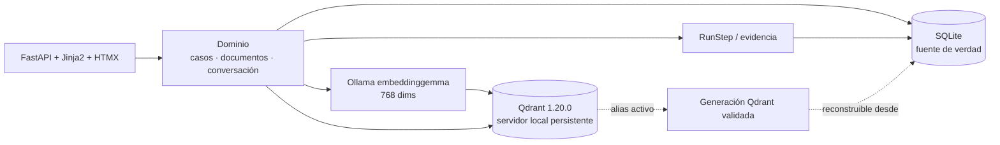

# Implementation Plan: Migración del índice documental a Qdrant

**Branch**: `004-qdrant-vector-index` (no creada) | **Date**: 2026-11-11 | **Spec**:
[spec.md](./spec.md)

**Input**: Feature specification from `/specs/004-qdrant-vector-index/spec.md`

**Note**: Este plan es documental. No implementa código, no instala dependencias, no levanta
servicios, no ejecuta migraciones ni modifica datos.

## Summary

Sustituir Chroma por **Qdrant 1.20.0** como único backend de recuperación documental. Qdrant se
ejecuta en un servidor local persistente con Docker Compose, accesible solo desde loopback. El
índice se reconstruye desde cero desde los fragmentos persistidos en SQLite; no se migran ni
exportan vectores de Chroma, no hay escritura dual, no hay selección permanente de backend, no se
exige comparación Chroma/Qdrant y no hay retorno a Chroma. SQLite, documentos, versiones,
fragmentos, citas históricas, conversaciones, revisiones, checkpoints, importaciones Qualys y
evidencia se conservan. Los embeddings se regeneran con el modelo local vigente.

## Technical Context

**Language/Version**: Python 3.14.6 (fijado por el proyecto)

**Primary Dependencies**: FastAPI, Jinja2, HTMX, LangChain, LangGraph, SQLAlchemy/Alembic, Ollama
(`embeddinggemma`), `qdrant-client==1.20.0`, pytest/Ruff/pre-commit.

**Storage**: SQLite como fuente de verdad; Qdrant 1.20.0 como índice derivado persistente. No se
crean tablas SQLite nuevas. Los archivos Chroma existentes no se usan ni se borran.

**Testing**: pytest; unitarias del adaptador con Qdrant local en modo embebido; integración y
aceptación contra el servidor Qdrant 1.20.0 con embeddings locales; fixtures públicos o ficticios
en almacenamiento separado.

**Target Platform**: macOS arm64 local, un proceso y un worker, Docker Compose para Qdrant.

**Project Type**: Aplicación web monolítica modular.

**Performance Goals**: No se inventan p95. Se medirán tiempo de reconstrucción, latencia de consulta
y cantidad de puntos; los umbrales de aceptación se fijan con la evaluación funcional reproducible.

**Constraints**: Qdrant solo en loopback; sin autenticación multiusuario; sin Chroma como backend;
sin exportación de vectores; sin dual-write; sin comparación obligatoria; sin retorno a Chroma; sin
indexar Qualys; sin cambiar embeddings ni generador; sin datos privados en fixtures. Toda instancia
DEBE tener un `SECGUARD_INSTANCE_ID` estable y un namespace Qdrant aislado; no se generan IDs en
cada arranque.

**Scale/Scope**: Corpus público actual, dos casos ficticios de prueba y documentos existentes del
usuario. La reconstrucción se valida primero en almacenamiento separado.

## Constitution Check

*GATE: Must pass before Phase 0 research. Re-check after Phase 1 design.*

Constitución aplicable: **1.3.0**, con ratificación comunicada por Edwin Perez L. el 2026-11-11.
No constan los acuerdos de Cristian Quebrada y Ruben Dario Sabogal; no se inventan.

| Principio | Cumplimiento |
|---|---|
| I. Propósito y alcance | Qdrant es un cambio de backend documental; no cambia el alcance, no certifica y no implementa P1–P4. |
| III. Arquitectura modular | Qdrant es índice derivado; SQLite sigue siendo fuente de verdad; sin microservicios de dominio; servidor local con Docker Compose. |
| IV. Persistencia local e inferencia autorizada | Embeddings locales sin cambio; no se cambia el generador; no hay llamadas pagadas. |
| V. Recuperación verificable | Se conservan procedencia, versiones, citas y localizadores; reconstrucción con verificación de integridad. |
| VI. Separación de datos | Corpus público y documentos privados por caso; sin Qualys en el RAG. |
| VII. Seguridad | Alcance por caso en código; acceso local; secretos fuera de logs; sin acciones externas. |
| VIII. Evidencia e incertidumbre | Se registra Qdrant, versión, índice y conteos; no se inventan resultados. |
| XI. Observabilidad y costos | Sin proveedor API ni gasto; evidencia local; no se declara una mejora no medida. |
| XII. Desarrollo incremental | 004 es el primer paso antes de 005/006/007 y del retorno de 003. |
| XIII. Frontera de datos | Solo datos públicos/ficticios en pruebas; no sale información privada; sin proveedores externos. |
| XIV. Acciones operativas | No aplica en 004; no se añaden acciones externas. |

**Resultado:** no hay violaciones que requieran Complexity Tracking. La única condición de gobierno
es la evidencia faltante de los acuerdos de Cristian/Ruben; se registra y no se inventa.

## Project Structure

### Documentation (this feature)

```text
specs/004-qdrant-vector-index/
├── plan.md
├── research.md
├── data-model.md
├── quickstart.md
├── contracts/
│   ├── index-adapter.md
│   ├── rebuild.md
│   ├── retrieval.md
│   └── evidence.md
├── spec.md
└── checklists/requirements.md
```

### Source Code (repository root)

```text
src/secguard_advisor/
├── config.py                    # Qdrant URL/timeout; retirar chroma_dir
├── retrieval/
│   ├── index.py                 # reemplazar ChromaIndex por QdrantIndex
│   ├── collections.py           # nombres físicos, alias y generaciones
│   ├── instance.py              # SECGUARD_INSTANCE_ID, marcador, hash y file lock
│   └── search.py                # puntuación/threshold de Qdrant; resolver SQLite
├── documents/service.py         # mismo IndexProtocol; sin cambios de dominio
├── web/app.py                   # fábrica Qdrant; readiness y errores
├── conversation/nodes.py        # evidencia de recuperación con Qdrant
└── evidence/                    # sin tablas nuevas; detalle en RunStep

scripts/
├── ingest_corpus.py             # Qdrant en lugar de Chroma
├── prepare_demo.py              # Qdrant en lugar de Chroma
└── rebuild_qdrant.py            # reconstrucción explícita e idempotente

compose.qdrant.yml               # Qdrant 1.20.0 local persistente
Makefile                         # qdrant-up/down/rebuild/health
pyproject.toml                   # + qdrant-client==1.20.0; - langchain-chroma
tests/
├── unit/                        # adaptador, IDs, payload, alias, score
├── contract/                    # contratos de índice/recuperación/evidencia
├── integration/                 # Qdrant server + embeddings locales
└── acceptance/                  # recorrido 001/002 y evaluación funcional
```

**Structure Decision**: se conserva el monolito modular y el layout actual. No se crea un paquete
nuevo ni una capa de dos backends. Qdrant se encapsula detrás del protocolo de índice existente.

## Architecture and Design

### Runtime topology



### Qdrant deployment

- Servidor Qdrant **1.20.0** en Docker Compose, imagen fijada `qdrant/qdrant:v1.20.0`.
- Cliente `qdrant-client==1.20.0`; compatibilidad verificada con servidor 1.20.0.
- Puertos solo loopback: `127.0.0.1:6333` (REST) y `127.0.0.1:6334` (gRPC).
- Volumen persistente: `./storage/qdrant:/qdrant/storage`.
- Sin autenticación multiusuario; el acceso se limita a loopback. No se expone a la red.
- `GET /readyz` como sonda de disponibilidad; la aplicación falla de forma explícita si no responde.
- No se usa Qdrant Cloud. El modo embebido del cliente queda para unitarias/pruebas; la aceptación
  se hace contra el servidor.

Compose de referencia (la implementación lo creará; no se crea aquí):

```yaml
services:
  qdrant:
    image: qdrant/qdrant:v1.20.0
    ports:
      - "127.0.0.1:6333:6333"
      - "127.0.0.1:6334:6334"
    volumes:
      - ./storage/qdrant:/qdrant/storage
    restart: unless-stopped
```

### Instance namespace

Cada instancia lógica tiene un **`SECGUARD_INSTANCE_ID`** explícito, estable y opaco. Es un slug
validado (`[a-z0-9][a-z0-9-]{2,39}`), se configura en entorno/`.env` y no se regenera al arrancar.
Ejemplos: `local-dev`, `presentacion-2026`, `test-<hash>`. No contiene rutas privadas.

El namespace se aplica a:

- colecciones públicas y privadas;
- aliases y generaciones;
- reportes de reconstrucción;
- locks de mantenimiento;
- nombres de evidencia y reportes.

Formato:

```text
secguard__<instance_id>__public__<model-slug>__<dim>__g<UTC>
secguard__<instance_id>__case__<case_id>__<model-slug>__<dim>__g<UTC>
secguard__<instance_id>__public__<model-slug>__<dim>__active
secguard__<instance_id>__case__<case_id>__<model-slug>__<dim>__active
storage/qdrant/locks/<instance_id>.lock
storage/qdrant/reports/<instance_id>/
```

**Vinculación persistente:** `storage/qdrant/instances/<instance_id>.json` guarda el
`instance_id`, un **SHA-256 del storage root canónico** (no la ruta legible), la versión de esquema y
la fecha de creación. Si el marcador no existe y Qdrant está vacío, se crea en el primer uso. Si el
marcador existe y no coincide con el `SECGUARD_INSTANCE_ID` o con el hash del storage actual, la
aplicación falla cerrada con `instance_namespace_mismatch`: no escribe, no cambia aliases y no usa
Chroma. Esto distingue una instancia copiada a otra ruta aunque conserve la misma SQLite.

`SECGUARD_INSTANCE_ID` ausente o inválido es un error de configuración. Las pruebas deben fijar un ID
propio y un storage separado; no se reutiliza el ID de presentación. El namespace incompatible no se
“adopta” automáticamente: requiere corrección de configuración o un procedimiento explícito futuro.

### Collections, aliases and generations

- Una colección física por alcance y generación:
  - `secguard__<instance_id>__public__<model-slug>__<dim>__g<UTC>`
  - `secguard__<instance_id>__case__<case_id>__<model-slug>__<dim>__g<UTC>`
- Un alias activo por alcance:
  - `secguard__<instance_id>__public__<model-slug>__<dim>__active`
  - `secguard__<instance_id>__case__<case_id>__<model-slug>__<dim>__active`
- La consulta usa el alias, nunca una generación parcial.
- La reconstrucción crea una generación nueva, valida el conjunto esperado y cambia el alias en una
  operación controlada solo si la validación pasa. Si el cambio falla, el alias anterior se conserva.
- Se conserva la generación anterior para recuperación; una limpieza separada y explícita podrá
  retirarla después. No se borran colecciones ajenas ni instancias del usuario.
- No hay tabla nueva: el estado de generación/alias vive en Qdrant y en un reporte JSON local de
  reconstrucción. Si el reporte no existe, el índice sigue siendo consultable por alias.

### Point identity and payload

- ID de punto: UUIDv5 determinista de `chunk_id` con un namespace fijo de SecGuard. El payload
  conserva `chunk_id` como identificador autoritativo; la aplicación resuelve el fragmento desde
  SQLite.
- Payload mínimo:
  `chunk_id`, `document_id`, `version_id`, `origin`, `source_id`, `page_start`, `page_end`,
  `section`, `locator`, `document_title`, `declared_version`, `chunk_index`,
  `embedding_model`, `embedding_dim`.
- No se copia el texto completo al payload: el texto y la procedencia se resuelven desde SQLite.
  Esto evita duplicación y conserva una sola fuente de verdad.
- Vector: 768 dimensiones, métrica `COSINE`, modelo `embeddinggemma` actual. No cambia el modelo.
- Índices de payload: `document_id`, `version_id`, `origin`; opcional `source_id` si el volumen lo
  justifica. No se indexa `text`.

### Version selection and citations

- Se indexan únicamente fragmentos de la **versión vigente disponible** de cada documento. Las
  versiones superadas no reaparecen en búsquedas nuevas.
- Las citas históricas no dependen de Qdrant: se resuelven desde `DocumentChunk`,
  `DocumentVersion` y `Document` en SQLite, conservando localizador y texto.
- El control automático de citas se mantiene igual: existencia, versión, documento, página/sección
  y cita literal.
- Una reconstrucción no modifica documentos, versiones, fragmentos, citas ni revisiones.

### First-document lifecycle (incremental)

Un caso nuevo sin colección ni alias no requiere una reconstrucción manual. El flujo de ingesta
crea el índice del caso cuando el primer documento queda realmente disponible:

1. La ingesta valida y persiste el documento, la versión y los fragmentos en SQLite; la versión
   permanece `processing`/no disponible.
2. Genera los embeddings locales y prepara los puntos con UUIDv5 y payload.
3. La ingesta adquiere el lock de escritura de la instancia y verifica si existe el alias del caso.
4. Si no existe, crea la colección/generación inicial del caso y sube los puntos de la versión.
5. Valida que los `chunk_id` de la versión estén en Qdrant y que la versión siga disponible en
   SQLite.
6. Publica el alias del caso; recién entonces la versión se marca `available` y es consultable.
7. Si la extracción, el embedding o la escritura en Qdrant fallan, la versión queda `failed`/no
   disponible; no se publica alias nuevo. Si el caso ya tenía alias, se conserva el alias anterior y
   la versión fallida no se resuelve.
8. El reintento usa el mismo flujo. Los puntos de la versión se borran por `version_id` como
   limpieza best-effort; el UUIDv5 y la verificación evitan duplicar fragmentos válidos. Los
   fragmentos huérfanos no se resuelven porque su versión no está disponible en SQLite.
9. Un documento posterior usa el alias existente; no crea una generación nueva por documento salvo
   que una reconstrucción explícita lo haga.

Esto es **incremental** y distinto de la reconstrucción inicial de documentos existentes: la
reconstrucción crea una generación nueva para todo el alcance y cambia el alias; la ingesta del
primer documento solo crea el índice mínimo necesario para ese caso.

### Rebuild workflow

Comando objetivo: `uv run python scripts/rebuild_qdrant.py` (o target `make qdrant-rebuild`).

1. Verificar Qdrant `/readyz`, versión 1.20.0 y compatibilidad del cliente.
2. Leer SQLite y seleccionar documentos/versiones vigentes disponibles; validar texto, modelo y
   dimensión.
3. Regenerar embeddings con `embeddinggemma` local en lotes acotados; no se usan vectores de Chroma.
4. Crear una colección de generación nueva y subir puntos con IDs deterministas.
5. Comparar el conjunto de `chunk_id` esperado contra el recuperado desde Qdrant; verificar conteos
   y muestras de payload.
6. Si coincide, cambiar el alias activo en una operación controlada; si falla, conservar el alias
   anterior; conservar la generación anterior.
7. Si falla o se interrumpe, no cambiar el alias; reportar estado parcial, puntos faltantes y causa.
8. Repetir es seguro: una nueva ejecución crea otra generación y no duplica puntos en la activa.

**Concurrencia entre procesos:** la reconstrucción y la ingesta adquieren el mismo **lock de archivo
exclusivo** de la instancia, `storage/qdrant/locks/<instance_id>.lock`, mediante `flock`/equivalente
del sistema operativo. No es un lock en memoria: cualquier proceso que use el mismo storage e
instancia lo respeta, y el sistema operativo lo libera si el proceso muere.

- La reconstrucción intenta adquirirlo al inicio y lo libera en `finally`.
- La ingesta lo adquiere para la escritura del índice y lo libera al terminar.
- Si la reconstrucción ya lo tiene, una ingesta nueva recibe `409 reconstruction_in_progress` y no
  escribe a medias.
- Si una ingesta lo tiene, la reconstrucción falla con `ingestion_in_progress`; no espera
  indefinidamente ni crea una cola.
- Las consultas no toman el lock: siguen usando el alias anterior hasta el cambio.
- Tras una interrupción, el lock se libera por el sistema operativo; el reporte queda `failed` o
  `partial` y el alias no cambia.
- El lock se particiona por `instance_id`: dos instancias en el mismo servidor Qdrant no se bloquean
  entre sí.

**Documentos añadidos durante la reconstrucción:** la ingesta se rechaza mientras dura; los
documentos que ya estaban en SQLite y no entraron en la generación se incluyen en la siguiente
reconstrucción. No hay promesa de actualización de Chroma.

### Failure behavior

- Qdrant inaccesible o `/readyz` falla: error explícito, sin fallback a Chroma.
- Versión incompatible: fallo antes de crear/escribir; no se cambia el alias.
- Dimensión/modelo incompatible: se reporta y no se mezcla; no se cambia el alias.
- Reconstrucción parcial: el alias no cambia; el reporte indica qué falta.
- Reinicio de Qdrant: el volumen persiste; el alias sigue disponible.
- Fallo de una generación: se conserva la anterior; se reintenta la reconstrucción.
- Nunca se reconstruye SQLite desde Qdrant.

### Empty scope vs missing index

La consulta decide con SQLite, no con la ausencia de alias:

| Estado | Comportamiento |
|---|---|
| Caso sin documentos privados disponibles | No es un error. Se consulta el corpus público; el alcance privado se omite. |
| Caso con documentos disponibles en SQLite pero sin alias de caso | `case_index_unavailable`/integridad; no se responde solo con público ni se declara “sin evidencia”. |
| Corpus público con documentos en SQLite pero sin alias público | `public_index_unavailable`; no se declara ausencia de evidencia. |
| Corpus público no configurado o vacío (sin documentos en SQLite) | Se omite el alcance público; la consulta del caso puede continuar. Si tampoco hay caso, el resultado es `empty` normal. |
| Qdrant inaccesible | `qdrant_unavailable`; error explícito, sin Chroma. |
| Alias presente pero sin resultados | `empty` normal; no se infiere ausencia de evidencia ni se inventa cita. |

El “esperado” se calcula desde SQLite: documentos/versiones vigentes disponibles y fragmentos
indexables. Un alias ausente con `expected > 0` es un fallo de disponibilidad/integridad, no un
alcance vacío. Un alcance realmente vacío no bloquea la consulta pública.

### Chroma retirement

- Se reemplazan `ChromaIndex`, `chroma_dir`, la fábrica de índice y las dependencias
  `langchain-chroma`/`chromadb` en el código de producto.
- Se actualizan scripts de ingesta/demo, fixtures y pruebas que instancian Chroma.
- Se elimina la selección de backend: no existe `SECGUARD_VECTOR_BACKEND=chroma|qdrant` ni
  dual-write.
- No se borran `storage/chroma`, archivos ni bases existentes. La limpieza física queda fuera de
  004 y requiere autorización separada.
- Las referencias históricas a Chroma en documentación/evidencia se conservan como tales.

### Evidence

- Sin tablas nuevas. El paso `retrieve` de `RunStep.detail_json` registra:
  `vector_backend="qdrant"`, `instance_id`, `qdrant_version="1.20.0"`, `collection_alias`,
  `generation`, `hits`, `status`.
- La página de ejecución conserva sus campos actuales y añade la identidad del índice sin exponer
  rutas locales ni secretos.
- La reconstrucción escribe un reporte JSON local con fecha, alcance, generación, conteos,
  discrepancias y resultado. No es estado de negocio ni fuente de verdad.

### Threshold calibration

- La métrica es `COSINE`; Qdrant devuelve similitud (mayor es mejor). No se reutiliza el `1 -
  distance` de Chroma sin comprobar el significado.
- Se usa un conjunto reproducible de preguntas relevantes, marginales y fuera de dominio.
- Se registran distribuciones de score y se elige un umbral que separe candidatos débiles sin
  ocultar evidencia pertinente. El valor inicial propuesto se marca como propuesto; el valor
  observado se registra tras la evaluación.
- No se declara equivalencia con el umbral 0.35 de Chroma.

## Phase 0 — Research

Ver [research.md](./research.md). Decisiones principales:

- Qdrant server 1.20.0 + `qdrant-client==1.20.0`; Docker Compose con volumen local.
- Colecciones por alcance + aliases + generaciones; sin tabla nueva.
- UUIDv5 determinista para IDs de punto; `chunk_id` en payload.
- Payload de metadatos sin texto; resolución de texto/citas en SQLite.
- Solo versión vigente indexada; citas históricas desde SQLite.
- Reconstrucción limpia con lock, validación y cambio de alias; sin exportación de vectores.
- Umbral calibrado con Qdrant; no copiado de Chroma.
- Retiro de Chroma del código, sin borrar sus datos.

## Phase 1 — Design

Ver [data-model.md](./data-model.md) y [contracts/](./contracts/). No se crean tablas nuevas.
Se reutilizan `DocumentChunk`, `DocumentVersion`, `Document`, `RunStep` y la evidencia existente.
Qdrant aporta colecciones, aliases, puntos y payload; el reporte de reconstrucción es JSON local.

## Testing and Acceptance

- Unitarias: mapeo de payload, UUIDv5, alias/generación, namespace, score, errores, selección de
  versiones, lock y estados de primer documento.
- Contrato: adaptador de índice, reconstrucción, recuperación, evidencia, namespace y lifecycle.
- Integración: Qdrant 1.20.0 server + Ollama embeddinggemma; ingesta, consulta, citas, aislamiento,
  reinicio, caída y configuración incompatible.
- Concurrencia real: dos procesos (aplicación y comando) compiten por el lock de instancia; se
  comprueba rechazo, liberación tras kill y ausencia de escritura parcial.
- Aceptación: corpus público, dos casos ficticios, **dos instancias con el mismo `case_id` y
  contenidos distintos**, primer documento, alcance vacío, versiones superadas/citas históricas,
  reconstrucción repetida/interrumpida, ausencia de Qualys y regresión 001/002.
- Datos: públicos/ficticios; almacenamiento separado; sin tocar instancias del usuario.
- No se inventan métricas; se distinguen umbrales propuestos y observados.

## Risks and Mitigations

| Riesgo | Mitigación |
|---|---|
| Acuerdos de Cristian/Ruben no constan | Registrado; no se inventa; ratificación del responsable registrada |
| Qdrant 1.20.0 nuevo | Versión exacta servidor/cliente; verificación `/readyz` y compatibilidad; pruebas de contrato |
| Re-embedding costoso | Lotes, progreso, reintento; no se inventan tiempos; medir antes de aceptar |
| Índice parcial visible | Generación + alias; el alias solo cambia tras validar; primer documento publica alias solo tras éxito |
| Namespace incompatible o storage copiado | `SECGUARD_INSTANCE_ID` + marcador con hash de storage; fallo cerrado; tests usan ID propio |
| Diferencias de score Chroma/Qdrant | Calibración con Qdrant; no copiar 0.35 |
| Pérdida de citas históricas | Citas resueltas desde SQLite; no dependen de Qdrant |
| Borrado accidental de datos | No se borra Chroma; limpieza fuera de 004; backup previo para operaciones destructivas |
| Concurrencia de ingesta/reconstrucción | Lock de archivo por instancia, no en memoria; pruebas con dos procesos; sin cola |
| Primer documento sin alias | Ingesta crea generación y alias solo tras validar; fallo deja versión no disponible |
| Alcance vacío confundido con índice ausente | SQLite decide `expected`; alias ausente con datos esperados es error, no `empty` |
| Docker no disponible en el equipo | Modo embebido solo para unitarias; la aceptación requiere servidor; documentar requisito |

## Dependencies and Ordering

1. Ratificación del responsable registrada; acuerdos del equipo no constan.
2. Confirmar Qdrant 1.20.0 server/client y Compose.
3. Implementar adaptador/aliases/reconstrucción en una tarea posterior.
4. Retirar Chroma del código y dependencias, sin borrar datos.
5. Ejecutar integración/aceptación y actualizar demo.

## Expected Outcome

Un índice Qdrant local persistente, reconstruible e idempotente, con citas y aislamiento
equivalentes, sin Chroma como backend de producto y sin modificar los datos de negocio. La
documentación distinguirá claramente el estado actual (Chroma hasta implementar) del objetivo
Qdrant y no declarará Qdrant implementado antes de la aceptación.

## Complexity Tracking

No hay violaciones constitucionales que justificar. No se añaden tablas, microservicios ni una capa
permanente de dos backends.
